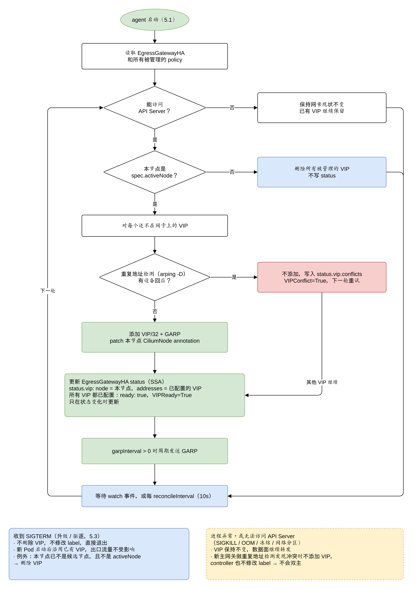

# cilium-egressgateway-ha 设计文档

## 1. 背景

Cilium 社区版的 Egress Gateway 可以把匹配的 Pod 流量转发到指定网关节点，并 SNAT 成固定的出口 IP（egressIP）。但它**不提供网关高可用**：

- 网关节点宕机后，流量不会切换到其他节点。
- Cilium 不会配置或迁移 egressIP（VIP）。
- 用户需要在 policy 中手动填写 egressIP、nodeSelector 等字段，填错会导致出口 IP 错误或流量被丢弃。

本项目由两个组件组成：

- **controller**：运行在 master 节点上，集中决定哪个候选节点是主网关，探测主网关是否故障，并提供 admission webhook 来补全和校验 egress policy。
- **agent**：以 DaemonSet 运行在候选网关节点上，只负责执行 controller 的决定，也就是在主网关上配置 VIP，在其他节点上删除 VIP。

## 2. Cilium 社区版行为分析

以下结论基于 Cilium 源码（`pkg/egressgateway`）阅读，并在 kind 集群（Cilium v1.20.5，tunnel/vxlan，KPR）中验证。

### 2.1 网关节点选择

- 每个 cilium-agent 根据 policy 的 `egressGateway.nodeSelector` 匹配 **CiliumNode** 的 labels。
- 多个节点同时匹配时，按节点名排序取第一个。
- 选择时**不检查**节点 Ready 状态，也不检查 agent 是否存活，没有 health check。
- 节点宕机后，它的 CiliumNode 仍然存在，labels 也不变。Cilium 会继续选择它，导致流量黑洞。operator 只会在 k8s Node 对象被删除后，才回收对应的 CiliumNode。

### 2.2 CiliumNode labels 的来源

- CiliumNode 的 labels 由**该节点自己的 cilium-agent** 从 k8s Node 同步过去，operator 不负责同步。
- 节点正常时，修改 k8s Node 的 label 会自动同步到 CiliumNode，所有 agent 都能感知，**不需要重启 agent**。
- 节点宕机后，它的 agent 也停止了。这时修改 k8s Node 的 label **不会同步**到 CiliumNode，必须直接修改 CiliumNode。
- 节点恢复后，agent 会按 k8s Node 的 labels 覆盖 CiliumNode 的 labels。
- 如果配置了 `exclude-node-label-patterns`，匹配的 label 不会同步到 CiliumNode。

### 2.3 egressIP 的查找时机

- Cilium **不会**把 egressIP 配置到网卡上。它只在网关节点上查找"哪块网卡拥有这个 IP"（或者这个 IP 是否被配置为 local route）。查找成功后，把 egressIP 写入 BPF egress map。
- 查找失败时，egressIP 被写成 `0.0.0.0`，网关节点会以 `No Egress IP configured` 的原因丢弃流量。
- 查找**由事件触发**。只有以下事件会让所有 agent 重新计算网关配置（`reconcileLocked` → `regenerateGatewayConfigs`）：
  - policy 新增、修改或删除
  - **任意** CiliumNode 新增、更新或删除
  - agent 启动后首次同步完成
- **网卡 IP 的增删不会触发重新查找。** 查找失败后，即使把 VIP 加到网卡上，流量也不会自动恢复。官方文档建议重新 apply policy。
- 官方文档默认的使用前提是：egressIP 由运维**预先**配置在固定的网关节点上，然后再创建 policy。

### 2.4 VIP 冲突

- 同一个二层网络中，如果多个节点同时持有 VIP，外部设备通过 ARP 找到哪个节点是不确定的。回包可能被送到备节点。备节点上没有这条连接的 SNAT 状态，回包会被丢弃。实测 6/6 次请求全部失败。
- 把 VIP 配到 `lo` 上也不能解决问题：默认 `arp_ignore=0` 时，`eth0` 仍然会响应 VIP 的 ARP。
- 因此，**任何时刻只能有一个节点持有 VIP**。

### 2.5 验证结果汇总

| 场景 | 结果 |
|---|---|
| 主节点在线，去掉 Node label，VIP 未迁移 | gatewayIP 自动切到备节点，但备节点上没有 VIP，流量被丢弃 |
| 在上一场景的基础上再迁移 VIP | 不会自动恢复，需要重建 policy |
| 先迁移 VIP，再修改 label | 立即生效 |
| 主节点宕机，不做任何处理 | 流量黑洞 |
| 主节点宕机，去掉 Node label | 不会同步到 CiliumNode，流量不恢复 |
| 主节点宕机，去掉 CiliumNode label（VIP 已迁移） | 立即恢复 |
| 两个节点同时持有 VIP | 流量全部失败 |
| VIP 晚于 policy 生效，然后 patch 本节点 CiliumNode 的 annotation | 立即恢复 |
| VIP 晚于 policy 生效，然后给 Node 打非 `cilium.io` 前缀的 annotation | 不会同步，流量不恢复 |
| VIP 晚于 policy 生效，然后给 Node 打 `xxx.cilium.io/` 前缀的 annotation | 同步到 CiliumNode，流量恢复 |
| 网关节点的 cilium-agent 重启（`kill -9`） | BPF map 保持不变，出口流量不受影响 |
| 新网关节点的 cilium-agent 不可用时，把 label 切到该节点 | 其他节点已经把网关切过来，但新网关节点本机没有下发 SNAT 配置，**流量持续中断**，直到该节点的 cilium-agent 恢复 |
| policy 同时填写 `egressIP` 和 `interface` | API Server 接受，对象可以创建；但所有 cilium-agent 都解析失败并忽略这个 policy（日志 `gateway configuration can't specify both an interface and an egress IP`），流量按没有 policy 处理，不报任何错误 |
| 网关节点上的 VIP 被删除，label 不变 | Cilium 不感知（见 2.3），BPF 仍然用 VIP 做 SNAT，回包按上游 ARP 缓存送回，所以在上游 ARP 表项过期前流量仍然正常 |
| VIP 设置 `valid_lft` 后停止刷新 | 到期后约 0.4s 内被内核删除，不需要用户态进程参与 |

## 3. 目标与非目标

**目标**

- 主网关节点故障时，自动把出口流量和 VIP 切换到备节点。
- **控制面问题不影响数据面**：本项目的 Pod 重启或升级、controller 重启、cilium-agent 重启、API Server 不可用，都不能触发主备切换，也不能中断出口流量。只有主网关节点不可达，或者 Node 变为 NotReady 时才切换。
- 任何时刻只有一个节点持有 VIP，并且只有一个节点被 Cilium 选为网关。
- 用户创建 policy 时，nodeSelector 写 `egress-gw-active: "true"` 就表示由本项目管理，egressIP 可以不填，由 webhook 自动补全；用户填写的字段由 webhook 校验。
- 不修改 Cilium，只使用社区版现有的行为。

**非目标**

- 切换时保持已有连接不断开。旧网关上的 SNAT 状态不会迁移，已有连接会断开。
- 在 API Server 不可用时完成切换。
- 多个网关之间的负载均衡。
- IPv6。

## 4. 总体设计


上图是稳态下的架构：

- 用户创建 nodeSelector 为 `egress-gw-active: "true"` 的 policy，controller 的 webhook 补全 egressIP。
- controller 探测主网关，在 `EgressGatewayHA` 对象的 `spec.activeNode` 中记录主网关，在 status 中记录各候选节点的状态，并维护 Node 和 CiliumNode 上的 `egress-gw-active` label。
- 主网关 A 上的 agent 看到自己是 `activeNode`，在网卡上配置 VIP，并把 VIP 状态写回 `EgressGatewayHA` 的 status。备节点 B 上的 agent 确保本机没有 VIP。
- 所有 cilium-agent 按 label 把 A 选为网关。业务 Pod 的出口流量经 VXLAN 送到 A，SNAT 成 VIP 后发往外部。

### 4.1 组件

| 组件 | 部署 | 职责 |
|---|---|---|
| controller | Deployment，2 副本，运行在 master 节点上。副本之间用一个 Lease 选出工作实例，两个副本都提供 webhook 服务 | 选择主网关；探测主网关；执行两阶段切换；维护所有节点 Node 和 CiliumNode 上的 `egress-gw-active` label；提供 mutating/validating webhook |
| agent | DaemonSet，只调度到匹配 `candidateNodeSelector` 的节点，`hostNetwork: true` | watch `EgressGatewayHA`；本节点是主网关时确保 VIP 存在，并上报 VIP 状态；不是主网关时删除 VIP |

controller 只负责做决定，agent 只负责执行。任何一方重启，最多只会让切换决策暂停一段时间，已经配置好的 VIP 和 Cilium BPF 配置保持不变，出口流量不受影响。

### 4.2 节点 label

候选节点不使用固定 label，而是由 `EgressGatewayHA` 中的 `candidateNodeSelector`（标准的 Kubernetes LabelSelector）选出。运维可以复用节点上已有的 label，例如机房、机架或节点角色。

本项目只维护一个 label：

| label | 维护者 | 含义 |
|---|---|---|
| `egress-gw-active=true` | controller 维护 | 当前主网关。任何时刻最多只有一个节点有这个 label。controller 会同时修改 Node 和 CiliumNode（原因见 2.2） |

controller 只给匹配 `candidateNodeSelector` 的节点打这个 label。每次 reconcile 时，controller 都会删除其他节点上的这个 label，包括被人误打上的。

### 4.3 配置与状态

配置分成两部分：

- **`EgressGatewayHA` CRD**：描述这组主备网关，包括候选节点、VIP 和当前主网关。运维可以在运行时修改。
- **全局默认配置**：控制 controller 和 agent 行为的参数，由 Helm values 渲染成启动参数，一般不需要修改。

**`EgressGatewayHA`**（集群级资源，API group `egressgateway-ha.spidernet.io`）：

```yaml
apiVersion: egressgateway-ha.spidernet.io/v1alpha1
kind: EgressGatewayHA
metadata:
  name: default                     # 全局只有一个实例，名字固定为 default
spec:
  candidateNodeSelector:            # 候选网关节点
    matchLabels:
      node-role.example.com/egress: "true"
  activeNode: ""                    # 当前主网关。默认为空，由 controller 选取后写入；运维修改即手动切换
  interface: eth0                   # 可选。agent 把 VIP 配到这块网卡上，不填时使用全局默认值。不会写入 policy（见 6.3）
  vipPool:                          # 允许使用的 VIP 范围
  - 192.168.10.100-192.168.10.110
  defaultEgressIP: 192.168.10.100   # policy 未填写 egressIP 时使用
status:
  activeNode: node1                 # 已经完成切换、带有 active label 的节点（controller 写）
  vip:                              # 主网关上的 VIP 状态（主网关的 agent 写）
    node: node1
    addresses: [192.168.10.100]
    ready: true
    conflicts: []
  candidates:                       # 各候选节点的状态（controller 写）
  - name: node1
    reachable: true                 # TCP 探测结果
    nodeReady: true
    ciliumReady: true
    agentReady: true
    lastProbeTime: "2026-11-20T06:00:00Z"
  - name: node2
    reachable: true
    nodeReady: true
    ciliumReady: true
    agentReady: true
    lastProbeTime: "2026-11-20T06:00:00Z"
  conditions:
  - type: Ready                     # controller：出口正常，label 已在 activeNode 上
    status: "True"
  - type: ActiveNodeReachable       # controller：主网关 TCP 探测成功
    status: "True"
  - type: Switching                 # controller：spec.activeNode 与 status.activeNode 不一致
    status: "False"
  - type: NoAvailableNode           # controller：没有可选作新主网关的节点
    status: "False"
  - type: VIPReady                  # 主网关的 agent：所有 VIP 都已配置
    status: "True"
  - type: VIPConflict               # 主网关的 agent：重复地址检测发现冲突
    status: "False"
```

- CRD schema 中用 CEL 规则（`self.metadata.name == 'default'`）限制只能创建一个实例。
- **`spec.activeNode` 是唯一的主网关来源。** controller 和运维都会写这个字段：
  - 默认为空。controller 选择可用候选节点中**字典序第一个**，写入这个字段（初次部署）。
  - 故障切换时，controller 把它改为新的主网关。
  - 计划内切换、故障恢复后切回，都由运维直接修改这个字段（见 5.6）。
- `status.activeNode` 表示切换已经完成的节点。`spec.activeNode` 和 `status.activeNode` 不一致，说明切换正在进行中。
- 故障节点恢复后，controller 不会自动把 `spec.activeNode` 改回去，以免已有连接再断开一次。

**status 的写入方**：

- controller 只知道 VIP **应该**配在哪个节点，不知道这个节点的网卡上**是否已经配好**。两阶段切换需要在 VIP 配好之后才修改 label（见 5.5），所以 `status.vip` 和 `VIPReady`、`VIPConflict` 两个 condition 由主网关上的 agent 写入，其余字段由 controller 写入。
- 只有 `spec.activeNode` 节点上的 agent 写 status，备节点的 agent 不写，所以同一时刻只有一个 agent 写。
- 两方都用 Server-Side Apply 更新 status，使用不同的 field manager，各自只管理自己的字段。conditions 声明为 `listType=map`、`listMapKey=type`，所以按 condition 类型分属不同的 field manager，不会互相覆盖。切换主网关时，新主网关的 agent 用 force apply 接管 `status.vip`。
- controller 只有在 `status.vip.node` 等于 `spec.activeNode` 时，才认为 `status.vip` 有效，避免使用旧主网关留下的结果。

**全局默认配置**（Helm values）：

```yaml
nodeProbe:
  port: 10250                       # 探测节点上的 TCP 端口，默认是 kubelet 端口
  timeout: 2s                       # 单次 TCP 连接超时，期间内核会自动重传 SYN
  interval: 5s                      # 探测间隔：上一次探测结束后，等待多久发起下一次
  failureThreshold: 3               # 连续失败多少次后判定节点故障
garpInterval: 0s                    # 周期性发送 GARP 的间隔，0 表示只在添加 VIP 时发送
defaultInterface: eth0              # EgressGatewayHA 未指定 interface 时使用
reconcileInterval: 10s              # agent 定期 reconcile 的间隔
```

### 4.4 Egress policy

不使用额外的 label 或 annotation 标识被管理的 policy。**nodeSelector 中包含 `egress-gw-active` 的 policy，就是本项目管理的 policy。** 用户需要自己写 nodeSelector，egressIP 可以不写：

```yaml
apiVersion: cilium.io/v2
kind: CiliumEgressGatewayPolicy
metadata:
  name: egress-app-a
spec:
  selectors:
  - podSelector:
      matchLabels:
        io.kubernetes.pod.namespace: app-a
        app: backend
  destinationCIDRs:
  - "0.0.0.0/0"
  excludedCIDRs:
  - "10.0.0.0/8"
  egressGateway:
    nodeSelector:
      matchLabels:
        egress-gw-active: "true"
    # egressIP 可以不写，由 webhook 填入 defaultEgressIP
```

- nodeSelector **只能**包含 `egress-gw-active: "true"` 这一个条件，由 validating webhook 检查（见 6.4）。原因是：如果还有其他条件，Cilium 会要求节点同时满足，当前主网关一旦不满足，流量就会被丢弃。
- nodeSelector 不包含 `candidateNodeSelector`。这样修改候选节点的 selector 时，不需要重新 patch 所有 policy。`egress-gw-active` label 只会出现在候选节点上，由 controller 保证（见 4.2）。
- **VIP 可以复用**：多个 policy 可以使用同一个 egressIP。所有被管理的 policy 共用同一个主网关，同一个 VIP 只需在主网关上配置一次。Cilium 在同一节点上用同一个 IP 为多个 policy 做 SNAT 没有冲突，源端口由 BPF NAT 统一分配。
- agent 需要配置的 VIP 集合 = 所有被管理 policy 的 egressIP 去重后的结果。只有当所有被管理的 policy 都不再使用某个 egressIP 时，才删除这个 VIP。

### 4.5 方案选择

#### 4.5.1 为什么由集中的 controller 决定主备

VIP 配置好以后，出口转发只依赖两样东西：主网关网卡上的 VIP，以及 Cilium 的 BPF map。它和本项目的进程、API Server 都没有关系（见 2.5）。所以本方案按以下原则设计：

- **只按节点本身的状态切换。** controller 用 TCP 探测和 Node Ready 状态判断主网关是否故障，不用"本项目进程是否存活"来代表节点能否转发。
- **agent 只执行，不做决定。** agent 重启或升级时不删除 VIP（见 5.3），已经生效的数据面保持不变。
- **只有一个地方做决定。** 决策集中在 controller 的工作实例上，候选节点之间不需要互斥，也不会出现多个节点各自判断后同时接管。
- **先添加 VIP，再打 label**（见 2.3）。只有新主网关的 agent 确认 VIP 已经配好，controller 才修改 label，所以切换失败时流量仍然走旧主网关（见 5.5）。**只选本机 cilium-agent 就绪的节点作为新主网关**（见 2.5）。

#### 4.5.2 为什么不使用多节点匹配

多节点匹配方案的做法是：policy 的 nodeSelector 只匹配候选节点，Cilium 按节点名排序后选第一个作为主节点。主节点故障时，由某个组件删除它的 label，Cilium 就会选择下一个节点。

这个方案能实现切换，但还要回答三个问题：谁来判断主节点故障？由谁来执行切换？怎样避免两个节点同时持有 VIP？把这些问题都解决后，就需要一个统一做决定的组件。

| 问题 | 多节点匹配 | 集中 controller（本方案） |
|---|---|---|
| 谁是主节点 | 由 Cilium 按节点名排序决定。程序要自己复现 Cilium 的选择规则，才知道 VIP 应该配到哪个节点。这依赖 Cilium 的内部实现 | 由 controller 决定。policy 只匹配一个节点，所以 VIP 的位置和 Cilium 的选择总是一致 |
| 故障检测 | 需要备节点自己判断。如果监听 Node Ready，默认至少要 40s，而且 kubelet 故障也会被误判为节点故障 | controller 用 TCP 连接探测节点，约 16～21s；Node NotReady 也触发切换 |
| 误判时是否双主 | **会。** 备节点加上 VIP 后，旧主节点并不知道自己已被替换，还继续持有 VIP，流量全部中断（见 2.4） | 新主节点添加 VIP 前先做重复地址检测，发现冲突就不添加，也不修改 label（见 5.5） |
| 多个备节点之间的互斥 | 需要另外加一把锁 | 只有一个 controller 实例做决定 |
| 故障节点恢复后 | 候选 label 已经被删除，需要运维手动加回 | 候选节点由 `candidateNodeSelector` 决定，节点恢复后自动成为备节点 |
| 是否强制切回 | **会。** 候选 label 加回后，原主节点名字排序最靠前，Cilium 立即切回，但 VIP 还在备节点上，流量中断 | 不会。只有 `activeNode` 节点带有 active label |

#### 4.5.3 为什么不在每个节点上预先配置 VIP

- VIP 配在普通网卡上时，多个节点会同时响应 ARP，回包可能被送到备节点并被丢弃。实测流量全部失败（见 2.4）。
- VIP 配在 `lo` 上，并设置 `arp_ignore=1` 时，没有任何节点响应 ARP。上游需要通过静态路由或 BGP 把 VIP 指向当前主节点。这只是把"迁移 VIP"换成了"切换路由"，在实际网络中很难落地。

#### 4.5.4 与 MetalLB L2 模式的对比

MetalLB L2 模式也是"一个 IP 在多个节点之间主备切换"，以下内容基于 MetalLB 源码（`speaker/layer2_controller.go`、`internal/speakerlist/speakerlist.go`，commit `6be0662`）和官方文档 `concepts/layer2.md`。

| 方面 | MetalLB L2 | 本方案 |
|---|---|---|
| 选主方式 | **无状态、分布式**。每个 speaker 都收集同一组可用节点，按 `sha256(节点名 + "#" + IP)` 排序（可以用 `preferredNodes` 加权），排第一的节点宣告这个 IP。没有 Lease，也没有中心组件 | 中心化。controller 决定主网关并写入 `spec.activeNode`，选择结果有状态、不随节点增减而变化 |
| 可用节点 | memberlist 中存活的 speaker，排除带 `NetworkUnavailable` 条件或 `node.kubernetes.io/exclude-from-external-load-balancers` label 的节点，再按 L2Advertisement 的节点选择器过滤 | 候选节点中：TCP 探测可达、Node Ready、cilium-agent Ready、agent Pod Ready |
| 故障检测 | speaker 之间通过 memberlist（SWIM gossip）互相探测，秒级 | controller 从 master 节点用 TCP 连接探测节点，秒级 |
| IP 如何生效 | **不把 IP 配到网卡上**。speaker 在用户态响应 ARP，并发送 GARP，转发由 kube-proxy 完成 | Cilium 要求 egressIP 属于节点（配在网卡上或作为 local route），所以必须把 VIP 配到网卡上 |
| speaker/agent 升级 | speaker 退出时调用 memberlist `Leave`，其他 speaker 立即把它移出可用列表并重新计算，**升级会触发切换** | agent 退出时保留 VIP，升级不切换 |
| 节点恢复 | 节点重新加入后，如果它在排序中排第一（或 `preferredNodes` 权重更高），IP 会切回去 | 不切回 |
| 脑裂 | 官方文档承认：speaker 误判节点状态时，可能有多个节点同时宣告，或者没有节点宣告 | 重复地址检测；VIP 配好之前不修改 label |

**借鉴的点**：

- `exclude-from-external-load-balancers` label 可以作为一个可选的排除条件。
- 不借鉴 `NetworkUnavailable` 条件：它由云厂商的 route controller 或 CNI 设置。Cilium 只在 agent 启动时把它设为 False（reason `CiliumIsUp`），之后不再更新，不能反映运行时故障。kind 中实测，agent 重启、节点停机再启动后，这个 condition 的 `lastHeartbeatTime` 都没有变化。
- 支持周期性发送 GARP（MetalLB 的 `--gratuitous-arp-interval`，默认 0）。有些交换机的 FDB 老化时间比上游网关的 ARP 缓存短，需要定期刷新，对应配置中的 `garpInterval`。
- 计划内切换后，部分客户端更新 ARP 缓存可能较慢。MetalLB 的建议是旧主节点保留一段时间再下线；本方案中旧主节点必须删除 VIP 以避免冲突，所以只能依靠 GARP。

**不借鉴的点**：

- 无状态哈希选主：节点增减会改变排序结果，不满足"不切回"和"升级不切换"的要求。
- 用户态 ARP 响应：Cilium 要求 egressIP 必须属于节点，不能只响应 ARP。

## 5. 流程

5.1～5.3 是 agent 的流程，5.4～5.6 是 controller 的流程。



### 5.1 agent 启动

1. 读取 `EgressGatewayHA` 和所有被管理的 policy。
2. 如果本节点是 `spec.activeNode`，确保 VIP 存在（见 5.2），**不先删除**。升级前的旧 Pod 留下的 VIP 会被直接沿用，流量不受影响。
3. 如果本节点不是 `spec.activeNode`，删除本机所有被管理的 VIP。
4. 如果启动时无法访问 API Server，**保持网卡现状不变**，等能访问后再执行上面的步骤。

VIP 添加时带地址 label（例如 `eth0:egw`），所以按 label 就能找到本项目管理的 VIP，不依赖 API Server。VIP 只配置在内核中，不写入节点的网络配置文件，节点重启后会自动消失。

### 5.2 agent 稳态

agent 持续 watch `EgressGatewayHA` 和被管理的 policy，并每 `reconcileInterval`（默认 10s）reconcile 一次。无法访问 API Server 时，保持网卡现状不变。

**本节点是 `spec.activeNode`**：

1. 对每个还不在网卡上的 VIP，先做**重复地址检测**（发送源地址为 0.0.0.0 的 ARP 探测，相当于 `arping -D`）：
   - 有设备回应：说明其他节点仍然持有这个 VIP。不添加，把这个 VIP 写入 `status.vip.conflicts`，设置 `VIPConflict=True`，等待下一轮重试。
   - 没有回应：以 /32 添加 VIP，然后发送 GARP。
2. 新增了 VIP 时，patch 本节点 CiliumNode 的 annotation（例如 `egress-gw-ha/vip-synced=<timestamp>`），触发 Cilium 重新查找 egressIP（见 2.3）。
3. 更新 status：`status.vip.node` 为本节点，`addresses` 为已配置的 VIP；所有 VIP 都已配置时，`ready: true`，`VIPReady=True`。只在状态变化时更新。
4. 如果 `garpInterval > 0`，按间隔重发 GARP。

**本节点不是 `spec.activeNode`**：删除所有被管理的 VIP，不写 status。

### 5.3 agent 退出（SIGTERM）

- **不删除 VIP**，也不修改任何 label。Pod 升级、驱逐期间，VIP 和 Cilium 的 BPF 配置保持不变，出口流量不受影响。新 Pod 启动后按 5.1 沿用已有 VIP。
- 例外：如果本节点已经不匹配 `candidateNodeSelector`（节点退出候选），并且也不是 `spec.activeNode`，就删除 VIP。DaemonSet 在节点不再匹配时会删除 agent Pod，所以这种情况会走到这里。

### 5.4 controller：健康检测


只有 controller 的工作实例执行检测。主网关满足以下**任意一个**条件时，判定为故障，触发切换：

| 条件 | 典型场景 | 检测时间 |
|---|---|---|
| TCP 探测连续 `failureThreshold` 次失败 | 节点宕机、网络不可达 | 约 16～21s（见下文） |
| Node 的 `Ready` condition 为 `False` 或 `Unknown` | kubelet 故障、节点和 API Server 断开、节点资源耗尽 | kubelet 停止上报后，要等 kube-controller-manager 的 `node-monitor-grace-period`（默认约 40～50s）才变为 `Unknown` |

NotReady 时数据面不一定有问题，例如只停 kubelet 时，节点仍然能正常转发，这时切换会断开已有连接。但 NotReady 表示 Kubernetes 已经认为这个节点不健康，后续可能被驱逐或下线，所以也作为切换条件。

**TCP 探测**：controller 向主网关的 InternalIP 发起 TCP 连接，目标端口为 `nodeProbe.port`（默认 10250，kubelet 端口），超时 `nodeProbe.timeout`（默认 2s）。

探测是**串行**的：上一次探测结束（成功、被拒绝或超时）后，等待 `nodeProbe.interval`（默认 5s）再发起下一次。所以同一个节点不会同时有两个探测，timeout 也可以大于 interval。

节点宕机时的检测时间：

```
检测时间 ≈ failureThreshold × timeout + (failureThreshold − 1) × interval + [0, interval]
         = 3 × 2s + 2 × 5s + [0, 5s]
         ≈ 16～21s
```

最后一项是宕机时刻到下一次探测开始的等待时间。interval 默认 5s，是为了减少探测频率，并让连续 3 次失败覆盖约 15s 以上的时间窗口，避免短时间的网络抖动触发切换。调小 `timeout` 或 `interval` 可以缩短检测时间，但网络抖动时更容易误判。`timeout` 不建议小于 1s，否则内核来不及重传 SYN。

| 结果 | 判定 | 含义 |
|---|---|---|
| 连接成功 | 存活 | 节点内核和网络正常 |
| 连接被拒绝（RST） | 存活 | 节点内核和网络正常，只是 kubelet 没有监听，例如 kubelet 停止或重启 |
| 连接超时 | 失败 | 节点宕机，或者网络不可达 |

kind 实测结果如下（从 control-plane 探测 worker3）：

| 场景 | TCP 连接 10250 | HTTPS `10250/healthz` |
|---|---|---|
| 正常 | 成功 | 匿名访问返回 401；带 token 时返回 200（需要 `nodes/healthz` 权限） |
| 停止 kubelet | 0.01s 内被拒绝 → **存活** | 失败 |
| `docker pause` 节点（进程冻结，内核和 eBPF 仍在转发） | 成功 → **存活** | 超时 |
| `docker stop` 节点 | 超时 → **失败** | 超时 |

选择 TCP 连接，而不是 ping 或 HTTP healthz，原因如下：

- **只反映节点和网络。** HTTP healthz 反映的是 kubelet 进程是否健康。kubelet 的状态已经由 Node Ready 反映，TCP 探测只需要判断节点内核和网络是否正常。连接被拒绝时，说明节点内核还在响应，判定为存活。
- **有重传，不容易误判。** 单次连接超时内，内核会自动重传 SYN。Linux 的 SYN 初始重传间隔是 1s，2s 超时内会发送 2 个 SYN。ping 没有重传，而且 ICMP 经常被交换机和主机限速，内核默认也有 `icmp_ratelimit`，网络拥塞时容易误判。
- **不需要额外权限。** 只建立 TCP 连接，不发送 HTTP 请求，不需要 kubelet 的认证，也不需要 `NET_RAW` capability。kubelet 的 `10248/healthz` 默认只监听 127.0.0.1，从其他节点访问不到。

以下信号**不触发切换**：

| 信号 | 原因 |
|---|---|
| `NetworkUnavailable` 条件 | Cilium 只在 agent 启动时设置一次，不能反映运行时故障（见 4.5.4） |
| 主网关上的 agent Pod 未就绪 | agent 升级或重启时不删除 VIP，转发不受影响（见 5.3） |
| 主网关上的 cilium-agent 未就绪 | cilium-agent 重启时 BPF map 保持不变，转发不受影响（见 2.5） |

这些信号只用来记录 Event 和 metrics。其中 agent Pod 和 cilium-agent 的就绪状态，还会在选择新主网关时用来过滤目标节点（见 5.5）。

controller 对所有候选节点都执行探测，结果写入 `status.candidates`，主网关的探测结果同时反映在 `ActiveNodeReachable` condition 上。

探测只有 controller 一个观察点。为了避免 controller 所在节点自己的网络问题被误判为主网关故障，因 TCP 探测失败而切换前，还要确认至少有一个备选节点 TCP 探测成功。如果所有候选节点都探测失败，判定为 controller 自己的网络问题，不切换，只告警。

### 5.5 controller：两阶段切换

触发条件：

- `spec.activeNode` 为空（初次部署）。
- 主网关被判定故障（见 5.4）。
- 主网关不再匹配 `candidateNodeSelector`。
- 运维修改了 `spec.activeNode`（计划内切换，见 5.6）。

1. **选择新主网关**。先过滤出可用候选节点：匹配 `candidateNodeSelector`、TCP 探测成功、Node Ready、cilium-agent Ready、agent Pod Ready。后两个条件用来避开"切过去也无法转发"的节点：目标节点的 agent 不可用时，没有人添加 VIP；目标节点的 cilium-agent 不可用时，不会下发 SNAT 配置（见 2.5）。然后按触发原因选择：

   | 触发原因 | 选择规则 |
   |---|---|
   | 初次部署 | 字典序第一个 |
   | 故障切换，或主网关退出候选 | 按字典序排列可用候选节点，选**排在当前 `spec.activeNode` 之后的下一个**；当前节点已经排在最后时，回到第一个 |
   | 计划内切换 | 运维写入的节点。这个节点必须可用，否则 controller 记录 Warning Event，把 `spec.activeNode` 恢复为 `status.activeNode`，保持现状 |

   例如候选节点为 node1、node2、node3，当前 `spec.activeNode=node2`：node2 故障时选 node3；node3 也不可用时选 node1。这样主网关会在候选节点之间依次轮转，不会总是集中在字典序最前面的节点上。

   没有可用节点时只告警，保持现状。
2. **第一阶段：写入 `spec.activeNode`**。把 `spec.activeNode` 改为新节点（计划内切换时运维已经写好，跳过这一步）。
   - 新节点的 agent 做重复地址检测后添加 VIP，然后写入 `status.vip`（`node` 为新节点，`ready: true`）。
   - 旧节点如果还活着并能访问 API Server，它的 agent 会看到自己不再是 activeNode，于是删除 VIP。
3. **第二阶段：修改 label**。controller 看到 `status.vip.node` 等于 `spec.activeNode`，并且 `status.vip.ready` 为 true 后：
   1. 给新节点的 Node 和 CiliumNode 打上 `egress-gw-active=true`，触发 Cilium 重新查找 egressIP。这时 VIP 已经在网卡上，可以一次查找成功。
   2. 删除其他所有节点 Node 和 CiliumNode 上的 `egress-gw-active`。旧节点可能已经宕机，它的 agent 不会同步 Node label 的变化，所以 CiliumNode 必须单独处理（见 2.2）。
   3. 把 `status.activeNode` 更新为新节点。

**双主防护**：

- **重复地址检测**。只要旧节点还在回应 VIP 的 ARP，新节点就不会添加 VIP，切换停在第一阶段，并设置 `VIPConflict=True`。
- **VIP 配好之前不修改 label**。切换停在第一阶段时，label 仍然在旧节点上，Cilium 仍然把流量送到旧节点。如果旧节点只是和 controller、API Server 断开（例如被判定为 NotReady），它的数据面仍然正常，**出口流量不中断**。
- 旧节点恢复访问 API Server 后，它的 agent 看到自己不再是 `spec.activeNode`，于是删除 VIP；新节点的重复地址检测随之通过，切换完成。这时已有连接会断开一次。
- 节点真的宕机时，旧节点不再回应 ARP，切换时间约为检测时间（见 5.4）加上约 2s。

controller 的工作实例在切换中途重启时，新实例比较 `spec.activeNode` 和 `status.activeNode`，并结合 `status.vip` 恢复进度，继续执行第二阶段。

### 5.6 计划内切换

运维直接修改 `spec.activeNode`，例如维护前把主网关切走，或者故障恢复后切回原来的节点：

```bash
kubectl patch egressgatewayha default --type merge -p '{"spec":{"activeNode":"node1"}}'
```

- validating webhook 校验目标节点存在，并且匹配 `candidateNodeSelector`。
- controller 发现 `spec.activeNode` 和 `status.activeNode` 不一致，从第一阶段之后开始执行：旧节点的 agent 删除 VIP，新节点的重复地址检测通过后添加 VIP，然后 controller 修改 label（第二阶段）。
- 目标节点不可用（TCP 探测失败、NotReady、agent Pod 未就绪，或 cilium-agent 未就绪）时，controller 记录 Warning Event，并把 `spec.activeNode` 恢复为 `status.activeNode`。
- 中断时间约为一个 reconcile 周期加上 GARP 生效时间。已有连接会断开。

### 5.7 主节点宕机时序


| 时间 | 事件 |
|---|---|
| t0 | 主网关宕机，VIP 失效，CiliumNode label 仍然存在，流量黑洞 |
| t0 + ~16～21s | controller 连续 3 次 TCP 探测超时（每次 2s，间隔 5s），确认备节点可达，写入 `spec.activeNode=node2` |
| 再过约 1s | node2 的 agent 做重复地址检测（无回应），添加 VIP，发送 GARP，写入 `status.vip`（`ready: true`） |
| 再过约 1s | controller 给 node2 打 label，删除 node1 Node 和 CiliumNode 上的 label，所有 cilium-agent 把网关切到 node2，新建连接恢复 |
| node1 恢复 | agent 启动后发现自己不是 activeNode，删除残留 VIP（节点重启后 VIP 已经不存在），作为备节点运行，不切回。需要切回时，由运维修改 `spec.activeNode`（见 5.6） |

以上时间是根据设计参数推算的，尚未实测。

### 5.8 控制面故障时的行为

| 事件 | 是否切换 | 出口流量 |
|---|---|---|
| agent Pod 升级、重启、被删除 | 否 | 不受影响 |
| controller 重启或副本切换 | 否 | 不受影响，切换决策暂停 |
| cilium-agent 重启 | 否 | 不受影响，BPF map 保持不变 |
| kubelet 故障 | 是（约 40～50s 后 Node 变为 `Unknown`） | 切换前不受影响；如果旧节点仍持有 VIP 且 agent 能访问 API Server，agent 删除 VIP 后完成切换，已有连接断开 |
| API Server 不可用 | 否（controller 无法写入） | 不受影响 |
| 主网关和 controller、API Server 之间网络分区，二层正常 | 尝试切换，停在第一阶段（重复地址检测发现冲突） | 不受影响。分区恢复后完成切换，已有连接断开一次 |
| 主网关宕机 | 是 | 中断约 18～23s（推算值） |

## 6. Webhook

controller 的两个副本都提供 webhook 服务，不依赖工作实例。

### 6.1 Cilium 对 policy 的校验

以下结论基于 Cilium v1.20.5，在 kind 中验证：

- **Cilium 没有 admission webhook。** 安装 Cilium 后，集群中没有任何 mutating 或 validating webhook 配置。`CiliumEgressGatewayPolicy` 只靠 CRD 的 OpenAPI schema 校验。
- schema 中的必填字段：`selectors`、`destinationCIDRs`、`egressGateway`、`egressGateway.nodeSelector`。`egressIP` 和 `interface` 都可以不填，server dry-run 实测只写 nodeSelector 的 policy 可以创建。
- 两者都不填时，Cilium 使用网关节点默认路由网卡的 IP 作为出口 IP，不会报错。所以必须由 webhook 补全 egressIP。
- **不存在和 Cilium webhook 的顺序问题。** Kubernetes 的处理顺序固定为：mutating admission → CRD schema 校验（包括必填字段）→ validating admission。kind 中用 MutatingAdmissionPolicy 验证过：用户连 `egressGateway` 整个字段都不写，被补全后可以成功创建。多个 mutating webhook 之间的顺序无法控制，但 Cilium 没有 webhook，所以不受影响。

### 6.2 作用范围

- 只处理 nodeSelector 中引用了 `egress-gw-active` 的 `CiliumEgressGatewayPolicy`。`objectSelector` 只能按 label 过滤，不能看 spec，所以改用 webhook 配置中的 `matchConditions`（Kubernetes 1.30 GA）。这条 CEL 表达式由 API Server 在调用 webhook 之前执行：

  ```yaml
  matchConditions:
  - name: managed-by-egress-gw-ha
    expression: >
      has(object.spec.egressGateway) && has(object.spec.egressGateway.nodeSelector) &&
      ((has(object.spec.egressGateway.nodeSelector.matchLabels) &&
        'egress-gw-active' in object.spec.egressGateway.nodeSelector.matchLabels) ||
       (has(object.spec.egressGateway.nodeSelector.matchExpressions) &&
        object.spec.egressGateway.nodeSelector.matchExpressions.exists(e, e.key == 'egress-gw-active')))
  ```

  同时匹配 `matchExpressions`，是为了让 validating webhook 拒绝这种写法（见 6.4）。
- 处理 CREATE 和 UPDATE。UPDATE 时如果用户把 `egress-gw-active` 从 nodeSelector 中去掉，新对象不再匹配，policy 就不再由本项目管理。
- 不匹配的 policy 完全不受影响，不会被发送到 webhook，controller 故障也不会阻止它们的创建。
- 另外校验 `EgressGatewayHA`（见 6.5）。

### 6.3 Mutating

- 只补全 egressIP：`egressGateway.egressIP` 为空时，填入 `EgressGatewayHA` 的 `spec.defaultEgressIP`。
- **不补全 interface。** Cilium 不允许 policy 同时指定 `egressIP` 和 `interface`，否则所有 cilium-agent 都会忽略这个 policy（见 2.5）。VIP 配在哪块网卡，由 `EgressGatewayHA.spec.interface` 决定：agent 把 VIP 配到这块网卡上，Cilium 再按 egressIP 找到持有它的网卡。
- 不修改 nodeSelector，由用户自己填写。

用户可以省略 egressIP，原因见 6.1。

### 6.4 Validating

拒绝以下情况：

- nodeSelector 不是只有 `matchLabels: {egress-gw-active: "true"}`，例如 value 不是 `"true"`、还有其他 label，或者使用了 `matchExpressions`（原因见 4.4）。
- 填写了 `egressGateway.interface`。Cilium 不允许同时指定 `interface` 和 `egressIP`（见 2.5），而 mutating 一定会补全 egressIP。VIP 所在网卡由 `EgressGatewayHA.spec.interface` 指定。
- 使用了多网关字段 `egressGateways`。
- egressIP 不是 IPv4。
- egressIP 不在 `vipPool` 范围内。
- egressIP 和任意节点的 InternalIP 相同。

允许以下情况：

- 多个 policy 使用同一个 egressIP（见 4.4）。
- UPDATE 时修改 egressIP，只要新值通过上述校验。通过 `warnings` 提示用户：修改后已有连接会断开。

### 6.5 校验 EgressGatewayHA

- 名字必须是 `default`（CRD schema 中的 CEL 规则，不依赖 webhook）。
- `vipPool` 是合法的 IPv4 地址范围，`defaultEgressIP` 在 `vipPool` 中。
- `spec.activeNode` 非空时，节点必须存在，并且匹配 `candidateNodeSelector`。
- 修改 `vipPool` 时，如果已有被管理的 policy 使用的 egressIP 不在新范围内，拒绝修改。

### 6.6 运行时校验

admission webhook 有超时限制（默认 10s），只能做静态校验，不能执行 ARP 探测，也不能等待 VIP 生效。VIP 是否真的可用由运行时流程检查：

- agent 的重复地址检测结果（`status.vip.conflicts` 和 `VIPConflict` condition）。
- controller 根据 `EgressGatewayHA` 的 status，在对应 policy 上记录 Event，并暴露 metrics。例如：VIP 冲突、VIP 未就绪、没有可用的主网关。

### 6.7 其他

- `failurePolicy: Fail`。如果使用 `Ignore`，controller 不可用时，未填写 egressIP 的 policy 会直接进入集群，Cilium 会改用默认路由网卡的 IP，出口 IP 会悄悄出错。由于 `matchConditions` 只匹配被管理的 policy，其他 policy 不会被发送到 webhook，所以 `Fail` 不会影响它们。
- `sideEffects: None`。VIP 允许复用，webhook 不需要维护分配记录，没有副作用。
- TLS 证书：controller 启动时自签证书，保存到 Secret 中供两个副本共用，并 patch webhook 配置的 `caBundle`。不依赖 cert-manager。

## 7. 部署

### 7.1 controller

- Deployment，2 副本，调度到 master 节点（容忍 control-plane taint），副本之间用 Lease 选出工作实例。
- 不需要额外的 capability：TCP 探测使用普通 socket。
- 提供 webhook Service。

### 7.2 agent

- DaemonSet，`hostNetwork: true`。调度范围通过 nodeAffinity 限制在候选节点上。Helm 用同一个 value 同时渲染 DaemonSet 的 nodeAffinity 和 `EgressGatewayHA` 的 `candidateNodeSelector`，保证两者一致。如果运维只修改了 `EgressGatewayHA`，导致两者不一致，没有 agent Pod 的节点会被视为不可用，不会被选为主网关。
- capabilities：`NET_ADMIN`（增删 IP）、`NET_RAW`（发送 GARP、重复地址检测）。
- `updateStrategy` 使用 `maxSurge: 0`，避免同一节点上同时有两个 agent。
- readinessProbe：agent 连接上 API Server 并完成首次同步后才 Ready。controller 用 agent Pod 的 Ready 状态判断节点能否作为新主网关，不需要单独的心跳。

### 7.3 RBAC

| 资源 | controller | agent |
|---|---|---|
| `coordination.k8s.io/leases`（本命名空间） | get, create, update（选工作实例） | - |
| `egressgateway-ha.spidernet.io/egressgatewayhas` | get, list, watch, update（写入 `spec.activeNode`） | get, list, watch |
| `egressgateway-ha.spidernet.io/egressgatewayhas/status` | patch（Server-Side Apply） | patch（Server-Side Apply，只写 `status.vip` 和自己的 condition） |
| `nodes` | get, list, watch, patch | get（判断本节点是否仍匹配 `candidateNodeSelector`） |
| `cilium.io/ciliumnodes` | get, list, watch, patch | get, patch（只更新本节点的 annotation） |
| `cilium.io/ciliumegressgatewaypolicies` | get, list, watch | get, list, watch |
| `pods`（cilium 和本项目的命名空间） | get, list, watch（判断 cilium-agent 和 agent 是否 Ready） | - |
| `secrets`（本命名空间） | get, create, update（webhook 证书） | - |
| `mutatingwebhookconfigurations` / `validatingwebhookconfigurations` | get, patch（写入 caBundle） | - |
| `events` | create | - |

controller 只用 TCP 连接探测 kubelet 端口，不发送 HTTP 请求，所以不需要 `nodes/healthz` 或 `nodes/proxy` 权限。

## 8. 限制与风险

- **已有连接会中断**：切换网关时，旧网关上的 SNAT 状态会丢失，已有 TCP 长连接需要应用重新连接。
- **kubelet 故障会触发切换**：Node NotReady 是切换条件之一（见 5.4），所以 kubelet 停止或升级时间超过 `node-monitor-grace-period` 时，也会切换，已有连接断开。kubelet 升级前，可以先手动把主网关切走（见 5.6）。
- **网络分区恢复时的双主窗口**：如果旧主网关在二层也被完全隔离，新节点的重复地址检测会通过，切换完成。分区恢复时，如果旧节点的 agent 正常运行，它会立即删除 VIP；如果 agent 也不可用（例如一直 CrashLoop），两个节点会同时持有 VIP，直到 agent 恢复。这时 `VIPConflict` 不会被触发，需要依靠告警发现。
- **单一观察点**：故障检测只从 controller 所在节点发起。5.4 的"至少一个备选节点探测成功"可以排除 controller 自身网络故障，但不能排除"controller 到主网关这一条路径故障，而主网关对外网络正常"的情况。此时会尝试切换，但重复地址检测会阻止新节点添加 VIP，label 也不会修改，流量继续走旧节点。
- **重复地址检测的局限**：如果旧节点仍然回应 ARP，但已经无法转发，并且它的 agent 也无法访问 API Server，切换会一直停在第一阶段，出口中断，直到旧节点恢复或被下线。这时 `VIPConflict=True`，需要人工处理。
- **切换依赖新节点上的 agent**：新主网关的 agent 不可用时，第一阶段无法完成。所以选择新主网关时会检查 agent Pod 是否 Ready，生产环境建议至少部署 3 个候选节点。
- **探测端口被防火墙拦截**：如果节点防火墙（例如 Cilium host firewall 或 iptables）对 `nodeProbe.port` 直接丢包而不是拒绝，探测会超时，从而误判节点故障。部署时需要确认 controller 所在节点能访问候选节点的这个端口。
- **GitOps**：`spec.activeNode` 会被 controller 修改。如果用 ArgoCD、Flux 管理 `EgressGatewayHA`，需要忽略这个字段（例如 ArgoCD 的 `ignoreDifferences`），否则 GitOps 工具会把它改回去，触发一次计划内切换。
- **GARP**：上游交换机或路由器必须接受 GARP，并及时更新 ARP 表。
- **外部组件冲突**：节点上的网络管理组件可能会删除程序添加的 VIP。agent 通过定期 reconcile 恢复 VIP，但仍然要避免这类组件管理该网卡。
- **Cilium 行为依赖**：本设计依赖 Cilium 的内部行为，例如 CiliumNode 更新会触发重新查找 egressIP。升级 Cilium 前需要重新验证。

## 9. 设计决策

1. **集中 controller 决定主备，agent 只执行**：控制面问题不影响数据面（见 4.5.1）。
2. **故障检测**：TCP 探测主网关的 kubelet 端口连续超时（连接被拒绝视为存活），或者 Node 变为 NotReady，都触发切换。`NetworkUnavailable`、agent Pod 和 cilium-agent 的就绪状态不触发切换；后两者只在选择新主网关时用来过滤目标节点。
3. **双主防护**：重复地址检测；新主网关的 agent 确认 VIP 配好之前，不修改 label。VIP 不设有效期。
4. **配置与状态**：集群级 CRD `EgressGatewayHA`，全局只有一个实例。controller 在 status 中记录各候选节点的状态和 conditions，主网关的 agent 在 status 中记录 VIP 状态，两方用 Server-Side Apply 各自管理自己的字段。探测参数等全局默认配置由 Helm values 渲染成启动参数。
5. **候选节点与主网关**：候选节点由 `candidateNodeSelector` 选出。主网关记录在 `spec.activeNode`，默认为空，由 controller 选取字典序第一个后写入；运维修改这个字段即可手动切换。故障切换时选择字典序中排在当前主网关之后的下一个可用节点。
6. **不切回**：故障节点恢复后作为备节点运行，由运维修改 `spec.activeNode` 手动切回。
7. **共用一个主网关和一个 active label**：所有被管理的 policy 共用同一个主网关，切换时所有 VIP 一起迁移。
8. **VIP 可以复用**：多个 policy 可以使用同一个 egressIP，webhook 不需要维护分配记录。
9. **Webhook**：Cilium 没有 webhook，不存在顺序问题；用 `matchConditions` 只处理 nodeSelector 引用了 `egress-gw-active` 的 policy，不需要额外的 label；只补全 egressIP；校验 nodeSelector 和 egressIP；`failurePolicy: Fail`；自签证书。
10. **只支持 IPv4**。
