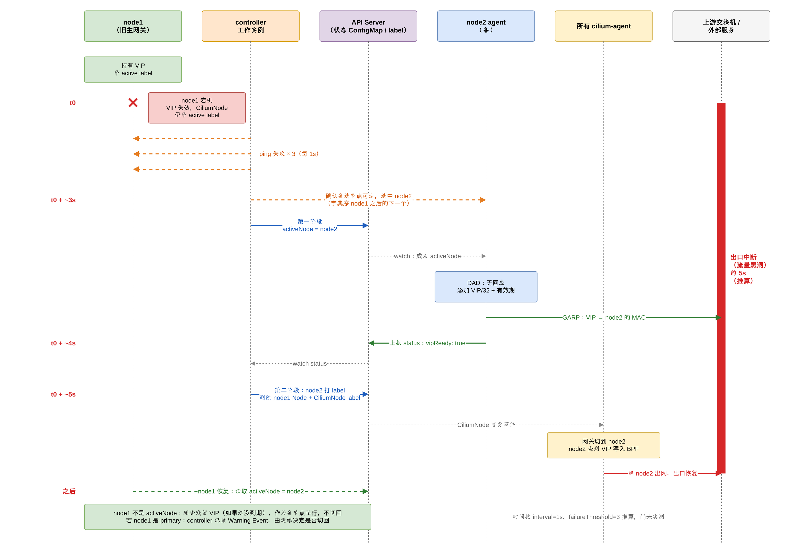

# cilium-egressgateway-ha 设计文档

## 1. 背景

Cilium 社区版的 Egress Gateway 可以把匹配的 Pod 流量转发到指定网关节点，并 SNAT 成固定的出口 IP（egressIP）。但它**不提供网关高可用**：

- 网关节点宕机后，流量不会切换到其他节点。
- Cilium 不会配置或迁移 egressIP（VIP）。
- 用户需要在 policy 中手动填写 egressIP、nodeSelector 等字段，填错会导致出口 IP 错误或流量被丢弃。

本项目由两个组件组成：

- **controller**：运行在 master 节点上，集中决定哪个候选节点是主网关，探测主网关是否故障，并提供 admission webhook 来补全和校验 egress policy。
- **agent**：以 DaemonSet 运行在候选网关节点上，只负责执行 controller 的决定，也就是在主网关上配置 VIP，在其他节点上删除 VIP。

## 2. Cilium 社区版行为分析

以下结论基于 Cilium 源码（`pkg/egressgateway`）阅读，并在 kind 集群（Cilium v1.20.5，tunnel/vxlan，KPR）中验证。

### 2.1 网关节点选择

- 每个 cilium-agent 根据 policy 的 `egressGateway.nodeSelector` 匹配 **CiliumNode** 的 labels。
- 多个节点同时匹配时，按节点名排序取第一个。
- 选择时**不检查**节点 Ready 状态，也不检查 agent 是否存活，没有 health check。
- 节点宕机后，它的 CiliumNode 仍然存在，labels 也不变。Cilium 会继续选择它，导致流量黑洞。operator 只会在 k8s Node 对象被删除后，才回收对应的 CiliumNode。

### 2.2 CiliumNode labels 的来源

- CiliumNode 的 labels 由**该节点自己的 cilium-agent** 从 k8s Node 同步过去，operator 不负责同步。
- 节点正常时，修改 k8s Node 的 label 会自动同步到 CiliumNode，所有 agent 都能感知，**不需要重启 agent**。
- 节点宕机后，它的 agent 也停止了。这时修改 k8s Node 的 label **不会同步**到 CiliumNode，必须直接修改 CiliumNode。
- 节点恢复后，agent 会按 k8s Node 的 labels 覆盖 CiliumNode 的 labels。
- 如果配置了 `exclude-node-label-patterns`，匹配的 label 不会同步到 CiliumNode。

### 2.3 egressIP 的查找时机

- Cilium **不会**把 egressIP 配置到网卡上。它只在网关节点上查找"哪块网卡拥有这个 IP"（或者这个 IP 是否被配置为 local route）。查找成功后，把 egressIP 写入 BPF egress map。
- 查找失败时，egressIP 被写成 `0.0.0.0`，网关节点会以 `No Egress IP configured` 的原因丢弃流量。
- 查找**由事件触发**。只有以下事件会让所有 agent 重新计算网关配置（`reconcileLocked` → `regenerateGatewayConfigs`）：
  - policy 新增、修改或删除
  - **任意** CiliumNode 新增、更新或删除
  - agent 启动后首次同步完成
- **网卡 IP 的增删不会触发重新查找。** 查找失败后，即使把 VIP 加到网卡上，流量也不会自动恢复。官方文档建议重新 apply policy。
- 官方文档默认的使用前提是：egressIP 由运维**预先**配置在固定的网关节点上，然后再创建 policy。

### 2.4 VIP 冲突

- 同一个二层网络中，如果多个节点同时持有 VIP，外部设备通过 ARP 找到哪个节点是不确定的。回包可能被送到备节点。备节点上没有这条连接的 SNAT 状态，回包会被丢弃。实测 6/6 次请求全部失败。
- 把 VIP 配到 `lo` 上也不能解决问题：默认 `arp_ignore=0` 时，`eth0` 仍然会响应 VIP 的 ARP。
- 因此，**任何时刻只能有一个节点持有 VIP**。

### 2.5 验证结果汇总

| 场景 | 结果 |
|---|---|
| 主节点在线，去掉 Node label，VIP 未迁移 | gatewayIP 自动切到备节点，但备节点上没有 VIP，流量被丢弃 |
| 在上一场景的基础上再迁移 VIP | 不会自动恢复，需要重建 policy |
| 先迁移 VIP，再修改 label | 立即生效 |
| 主节点宕机，不做任何处理 | 流量黑洞 |
| 主节点宕机，去掉 Node label | 不会同步到 CiliumNode，流量不恢复 |
| 主节点宕机，去掉 CiliumNode label（VIP 已迁移） | 立即恢复 |
| 两个节点同时持有 VIP | 流量全部失败 |
| VIP 晚于 policy 生效，然后 patch 本节点 CiliumNode 的 annotation | 立即恢复 |
| VIP 晚于 policy 生效，然后给 Node 打非 `cilium.io` 前缀的 annotation | 不会同步，流量不恢复 |
| VIP 晚于 policy 生效，然后给 Node 打 `xxx.cilium.io/` 前缀的 annotation | 同步到 CiliumNode，流量恢复 |
| 网关节点的 cilium-agent 重启（`kill -9`） | BPF map 保持不变，出口流量不受影响 |
| 新网关节点的 cilium-agent 不可用时，把 label 切到该节点 | 其他节点已经把网关切过来，但新网关节点本机没有下发 SNAT 配置，**流量持续中断**，直到该节点的 cilium-agent 恢复 |
| 网关节点上的 VIP 被删除，label 不变 | Cilium 不感知（见 2.3），BPF 仍然用 VIP 做 SNAT，回包按上游 ARP 缓存送回，所以在上游 ARP 表项过期前流量仍然正常 |
| VIP 设置 `valid_lft` 后停止刷新 | 到期后约 0.4s 内被内核删除，不需要用户态进程参与 |

## 3. 目标与非目标

**目标**

- 主网关节点故障时，自动把出口流量和 VIP 切换到备节点。
- **控制面问题不影响数据面**：本项目的 Pod 重启或升级、controller 重启、cilium-agent 重启、API Server 短时间不可用、kubelet 故障，都不能触发主备切换，也不能中断出口流量。只有主网关节点本身不可用时才切换。
- 任何时刻只有一个节点持有 VIP，并且只有一个节点被 Cilium 选为网关。
- 用户创建 policy 时可以不填 egressIP 和 nodeSelector，由 webhook 自动补全；用户填写的字段由 webhook 校验。
- 不修改 Cilium，只使用社区版现有的行为。

**非目标**

- 切换时保持已有连接不断开。旧网关上的 SNAT 状态不会迁移，已有连接会断开。
- 在 API Server 不可用时完成切换。
- 多个网关之间的负载均衡。
- IPv6。

## 4. 总体设计


上图是稳态下的架构：

- 用户创建带 `egress-gw-ha/managed` label 的 policy，controller 的 webhook 补全 egressIP 和 nodeSelector。
- controller 探测候选节点，把主网关写入状态 ConfigMap 的 `activeNode`，并维护 Node 和 CiliumNode 上的 `egress-gw-active` label。
- 主网关 A 上的 agent 看到自己是 `activeNode`，在网卡上配置带有效期的 VIP。备节点 B 上的 agent 确保本机没有 VIP。
- 所有 cilium-agent 按 label 把 A 选为网关。业务 Pod 的出口流量经 VXLAN 送到 A，SNAT 成 VIP 后发往外部。

### 4.1 组件

| 组件 | 部署 | 职责 |
|---|---|---|
| controller | Deployment，2 副本，运行在 master 节点上。副本之间用一个 Lease 选出工作实例，两个副本都提供 webhook 服务 | 选择主网关；探测主网关；执行两阶段切换；维护所有节点 Node 和 CiliumNode 上的 `egress-gw-active` label；提供 mutating/validating webhook |
| agent | DaemonSet，只调度到匹配 `candidateNodeSelector` 的节点，`hostNetwork: true` | watch 状态 ConfigMap；本节点是主网关时确保 VIP 存在，不是主网关时删除 VIP；上报心跳和 VIP 状态 |

controller 只负责做决定，agent 只负责执行。任何一方重启，最多只会让切换决策暂停一段时间，已经配置好的 VIP 和 Cilium BPF 配置保持不变，出口流量不受影响。

### 4.2 节点 label

候选节点不使用固定 label，而是由配置中的 `candidateNodeSelector`（标准的 Kubernetes LabelSelector）选出。运维可以复用节点上已有的 label，例如机房、机架或节点角色。

本项目只维护一个 label：

| label | 维护者 | 含义 |
|---|---|---|
| `egress-gw-active=true` | controller 维护 | 当前主网关。任何时刻最多只有一个节点有这个 label。controller 会同时修改 Node 和 CiliumNode（原因见 2.2） |

controller 只给匹配 `candidateNodeSelector` 的节点打这个 label。每次 reconcile 时，controller 都会删除其他节点上的这个 label，包括被人误打上的。

### 4.3 配置与状态

**配置 ConfigMap**（`kube-system/egress-gw-ha-config`，由运维维护）：

```yaml
data:
  config.yaml: |
    candidateNodeSelector:          # 候选网关节点
      matchLabels:
        node-role.example.com/egress: "true"
    primary: node1                  # 可选。期望的主网关，见下文
    interface: eth0                 # VIP 所在网卡，所有候选节点相同
    vipPool:                        # 允许使用的 VIP 范围
    - 192.168.10.100-192.168.10.110
    defaultEgressIP: 192.168.10.100 # policy 未填写 egressIP 时使用
    probe:
      interval: 1s                  # controller 探测主网关的间隔
      failureThreshold: 3           # 连续失败多少次后判定节点故障
      notReadyTimeout: 5m           # Node NotReady 持续多久后也判定为故障（兜底）
    selfFenceTimeout: 60s           # agent 连续多久无法访问 API Server 后删除 VIP（见 5.2）
    garpInterval: 0s                # 周期性发送 GARP 的间隔，0 表示只在添加 VIP 时发送
```

**状态 ConfigMap**（`kube-system/egress-gw-ha-state`，由 controller 维护）：

```yaml
data:
  activeNode: node2           # 当前实际的主网关，也就是应该持有 VIP 的节点
  observedPrimary: node1      # controller 已经处理过的 primary 值
  observedSwitchover: ""      # controller 已经处理过的切回请求（见 5.6）
```

**`primary` 和 `activeNode` 的关系**：

- `primary` 是运维**期望**的主网关，写在配置中；`activeNode` 是**实际**的主网关，由 controller 写在状态中。
- `primary` 只在两种情况下起作用：
  - 初次部署（`activeNode` 为空）。
  - 运维修改了 `primary` 的值，也就是 `primary` 不等于 `observedPrimary`。这时 controller 执行计划内切换（见 5.6）。
- 不指定 `primary` 时，初次部署选择可用候选节点中**字典序第一个**。
- 故障切换时，controller 只修改 `activeNode`，**不修改 `primary`**。原来的 primary 节点恢复后不会自动切回，以免已有连接再断开一次。这时 `activeNode` 和 `primary` 不一致，controller 在配置 ConfigMap 上记录 Warning Event，并通过 metrics 暴露这个状态。运维确认后，可以手动切回（见 5.6）。
- `primary` 不匹配 `candidateNodeSelector` 时，controller 忽略它，并记录 Warning Event。

配置和状态分成两个 ConfigMap，这样运维编辑配置时，不会覆盖 controller 写入的状态。

**agent 上报**：

- 心跳：每个 agent 维护一个自己的 Lease（`egw-ha-agent-<节点名>`），每 5s 续约一次。这个 Lease 只用来表示"agent 是否存活"，不参与选主。
- VIP 状态：agent 把状态写到本节点 Node 的 annotation `egress-gw-ha/status`，只在状态变化时更新，例如：

  ```json
  {"activeNode": "node2", "vips": ["192.168.10.100"], "vipReady": true, "conflict": []}
  ```

  `activeNode` 是 agent 当前看到的状态 ConfigMap 值。controller 只有在它和自己写入的值一致时，才认为上报结果有效，避免使用过期的上报。这个 annotation 没有 `cilium.io` 前缀，不会同步到 CiliumNode，也就不会触发 Cilium 重新计算（见 2.5）。

### 4.4 Egress policy

被管理的 policy 用 label `egress-gw-ha/managed: "true"` 标识。用户只需要写：

```yaml
apiVersion: cilium.io/v2
kind: CiliumEgressGatewayPolicy
metadata:
  name: egress-app-a
  labels:
    egress-gw-ha/managed: "true"
spec:
  selectors:
  - podSelector:
      matchLabels:
        io.kubernetes.pod.namespace: app-a
        app: backend
  destinationCIDRs:
  - "0.0.0.0/0"
  excludedCIDRs:
  - "10.0.0.0/8"
  # egressGateway 可以不写，也可以只写 egressIP
```

经过 mutating webhook 后，实际保存的是：

```yaml
  egressGateway:
    nodeSelector:
      matchLabels:
        egress-gw-active: "true"
    egressIP: 192.168.10.100   # 用户未填写时使用 defaultEgressIP
```

- nodeSelector 只匹配 `egress-gw-active`，不包含 `candidateNodeSelector`。这样修改候选节点的 selector 时，不需要重新 patch 所有 policy。label 只会出现在候选节点上，由 controller 保证（见 4.2）。
- **VIP 可以复用**：多个 policy 可以使用同一个 egressIP。所有被管理的 policy 共用同一个主网关，同一个 VIP 只需在主网关上配置一次。Cilium 在同一节点上用同一个 IP 为多个 policy 做 SNAT 没有冲突，源端口由 BPF NAT 统一分配。
- agent 需要配置的 VIP 集合 = 所有被管理 policy 的 egressIP 去重后的结果。只有当所有被管理的 policy 都不再使用某个 egressIP 时，才删除这个 VIP。

### 4.5 方案选择

#### 4.5.1 为什么由集中的 controller 决定主备

VIP 配置好以后，出口转发只依赖两样东西：主网关网卡上的 VIP，以及 Cilium 的 BPF map。它和本项目的进程、API Server 都没有关系（见 2.5）。所以本方案按以下原则设计：

- **只有主网关节点本身不能转发时才切换。** controller 直接探测节点网络来判断故障，不用"本项目进程是否存活"或"能否访问 API Server"来代表节点能否转发。
- **agent 只执行，不做决定。** agent 重启或升级时不删除 VIP（见 5.3），已经生效的数据面保持不变。
- **只有一个地方做决定。** 决策集中在 controller 的工作实例上，候选节点之间不需要互斥，也不会出现多个节点各自判断后同时接管。
- **VIP 带有效期，作为最后的自我隔离手段。** 有效期为 `selfFenceTimeout`（默认 60s），只在 agent 长时间无法访问 API Server 时生效（见 5.2）。
- **先添加 VIP，再打 label**（见 2.3）。**只选本机 cilium-agent 就绪的节点作为新主网关**（见 2.5）。

#### 4.5.2 为什么不使用多节点匹配

多节点匹配方案的做法是：policy 的 nodeSelector 只匹配候选节点，Cilium 按节点名排序后选第一个作为主节点。主节点故障时，由某个组件删除它的 label，Cilium 就会选择下一个节点。

这个方案能实现切换，但还要回答三个问题：谁来判断主节点故障？由谁来执行切换？怎样避免两个节点同时持有 VIP？把这些问题都解决后，就需要一个统一做决定的组件。

| 问题 | 多节点匹配 | 集中 controller（本方案） |
|---|---|---|
| 谁是主节点 | 由 Cilium 按节点名排序决定。程序要自己复现 Cilium 的选择规则，才知道 VIP 应该配到哪个节点。这依赖 Cilium 的内部实现 | 由 controller 决定。policy 只匹配一个节点，所以 VIP 的位置和 Cilium 的选择总是一致 |
| 故障检测 | 需要备节点自己判断。如果监听 Node Ready，默认至少要 40s，而且 kubelet 故障也会被误判为节点故障 | controller 直接探测节点网络，约 3s；Node NotReady 只作为长时间兜底 |
| 误判时是否双主 | **会。** 备节点加上 VIP 后，旧主节点并不知道自己已被替换，还继续持有 VIP，流量全部中断（见 2.4） | 新主节点添加 VIP 前先做重复地址检测；旧主节点长时间连不上 API Server 时主动删除 VIP（见 5.5） |
| 多个备节点之间的互斥 | 需要另外加一把锁 | 只有一个 controller 实例做决定 |
| 故障节点恢复后 | 候选 label 已经被删除，需要运维手动加回 | 候选节点由 `candidateNodeSelector` 决定，节点恢复后自动成为备节点 |
| 是否强制切回 | **会。** 候选 label 加回后，原主节点名字排序最靠前，Cilium 立即切回，但 VIP 还在备节点上，流量中断 | 不会。只有 `activeNode` 节点带有 active label |

#### 4.5.3 为什么不在每个节点上预先配置 VIP

- VIP 配在普通网卡上时，多个节点会同时响应 ARP，回包可能被送到备节点并被丢弃。实测流量全部失败（见 2.4）。
- VIP 配在 `lo` 上，并设置 `arp_ignore=1` 时，没有任何节点响应 ARP。上游需要通过静态路由或 BGP 把 VIP 指向当前主节点。这只是把"迁移 VIP"换成了"切换路由"，在实际网络中很难落地。

#### 4.5.4 与 MetalLB L2 模式的对比

MetalLB L2 模式也是"一个 IP 在多个节点之间主备切换"，以下内容基于 MetalLB 源码（`speaker/layer2_controller.go`、`internal/speakerlist/speakerlist.go`，commit `6be0662`）和官方文档 `concepts/layer2.md`。

| 方面 | MetalLB L2 | 本方案 |
|---|---|---|
| 选主方式 | **无状态、分布式**。每个 speaker 都收集同一组可用节点，按 `sha256(节点名 + "#" + IP)` 排序（可以用 `preferredNodes` 加权），排第一的节点宣告这个 IP。没有 Lease，也没有中心组件 | 中心化。controller 决定 `activeNode` 并写入 ConfigMap，选择结果有状态、不随节点增减而变化 |
| 可用节点 | memberlist 中存活的 speaker，排除带 `NetworkUnavailable` 条件或 `node.kubernetes.io/exclude-from-external-load-balancers` label 的节点，再按 L2Advertisement 的节点选择器过滤 | 候选节点中：Ready、没有 `NetworkUnavailable`、cilium-agent Ready、agent 心跳正常、网络可达 |
| 故障检测 | speaker 之间通过 memberlist（SWIM gossip）互相探测，秒级 | controller 直接 ping 节点 InternalIP，秒级 |
| IP 如何生效 | **不把 IP 配到网卡上**。speaker 在用户态响应 ARP，并发送 GARP，转发由 kube-proxy 完成 | Cilium 要求 egressIP 属于节点（配在网卡上或作为 local route），所以必须把 VIP 配到网卡上 |
| speaker/agent 升级 | speaker 退出时调用 memberlist `Leave`，其他 speaker 立即把它移出可用列表并重新计算，**升级会触发切换** | agent 退出时保留 VIP，升级不切换 |
| 节点恢复 | 节点重新加入后，如果它在排序中排第一（或 `preferredNodes` 权重更高），IP 会切回去 | 不切回 |
| 脑裂 | 官方文档承认：speaker 误判节点状态时，可能有多个节点同时宣告，或者没有节点宣告 | 重复地址检测 + 自我隔离 |

**借鉴的点**：

- 排除带 `NetworkUnavailable` 条件的节点。`exclude-from-external-load-balancers` label 也可以作为一个可选的排除条件。
- 支持周期性发送 GARP（MetalLB 的 `--gratuitous-arp-interval`，默认 0）。有些交换机的 FDB 老化时间比上游网关的 ARP 缓存短，需要定期刷新，对应配置中的 `garpInterval`。
- 计划内切换后，部分客户端更新 ARP 缓存可能较慢。MetalLB 的建议是旧主节点保留一段时间再下线；本方案中旧主节点必须删除 VIP 以避免冲突，所以只能依靠 GARP。

**不借鉴的点**：

- 无状态哈希选主：节点增减会改变排序结果，不满足"不切回"和"升级不切换"的要求。
- 用户态 ARP 响应：Cilium 要求 egressIP 必须属于节点，不能只响应 ARP。

## 5. 流程

5.1～5.3 是 agent 的流程，5.4～5.6 是 controller 的流程。


### 5.1 agent 启动

1. 读取配置和状态 ConfigMap，以及所有被管理的 policy。
2. 如果本节点是 `activeNode`，确保 VIP 存在（见 5.2），**不先删除**。升级前的旧 Pod 留下的 VIP 会被直接沿用，流量不受影响。
3. 如果本节点不是 `activeNode`，删除本机所有被管理的 VIP。
4. 如果启动时无法访问 API Server，**保持网卡现状不变**。已有的 VIP 带有效期，最多 `selfFenceTimeout` 后由内核删除。

VIP 添加时带地址 label（例如 `eth0:egw`），所以按 label 就能找到本项目管理的 VIP，不依赖 API Server。

### 5.2 agent 稳态

agent 持续 watch 状态 ConfigMap 和被管理的 policy，并每 10s reconcile 一次：

**本节点是 `activeNode`**：

1. 对每个还不在网卡上的 VIP，先做**重复地址检测**（发送源地址为 0.0.0.0 的 ARP 探测，相当于 `arping -D`）：
   - 有设备回应：说明其他节点仍然持有这个 VIP。不添加，在 status 中上报 `conflict`，等待下一轮重试。
   - 没有回应：以 /32 添加 VIP，并设置有效期，然后发送 GARP。
2. 刷新所有 VIP 的有效期：`lft = 最后一次成功访问 API Server 的请求开始时间 + selfFenceTimeout - now`。`lft ≤ 0` 时不再刷新，VIP 由内核删除（内核机制见 2.5）。这就是**自我隔离**：只有 agent 长时间无法确认"自己仍然是 activeNode"时，VIP 才会失效。
   - 必须用请求的**开始时间**计算，不能用请求返回的时间或当前时间。原因是：agent 进程如果在请求返回之后、刷新有效期之前被冻结（VM 暂停、长时间 GC），恢复后会按已经过时的结果给 VIP 续期。这时新主网关可能已经接管，就会出现双主。
3. 新增了 VIP 时，patch 本节点 CiliumNode 的 annotation（例如 `egress-gw-ha/vip-synced=<timestamp>`），触发 Cilium 重新查找 egressIP（见 2.3）。
4. 所有 VIP 都已添加时，上报 `vipReady: true`。
5. 如果 `garpInterval > 0`，按间隔重发 GARP。

**本节点不是 `activeNode`**：删除所有被管理的 VIP，上报 `vipReady: false`。

### 5.3 agent 退出（SIGTERM）

- **不删除 VIP**，也不修改任何 label。Pod 升级、驱逐期间，VIP 和 Cilium 的 BPF 配置保持不变，出口流量不受影响。新 Pod 启动后按 5.1 沿用已有 VIP。
- 例外：如果本节点已经不匹配 `candidateNodeSelector`（节点退出候选），并且也不是 `activeNode`，就删除 VIP。DaemonSet 在节点不再匹配时会删除 agent Pod，所以这种情况会走到这里。
- 升级必须在 `selfFenceTimeout` 内完成，否则 VIP 会到期删除。如果镜像拉取可能较慢，需要提前拉取镜像，或调大 `selfFenceTimeout`。

### 5.4 controller：健康检测


只有 controller 的工作实例执行检测。不同信号的用途分开：

| 信号 | 用途 |
|---|---|
| ping 节点 InternalIP，连续 `failureThreshold` 次失败 | **触发切换** |
| Node NotReady 持续超过 `notReadyTimeout`（默认 5m） | **触发切换**（兜底）。kubelet 重启或升级通常远小于这个时间 |
| 带有 `NetworkUnavailable` 条件 | **触发切换**（参考 MetalLB） |
| agent 心跳丢失、主网关上的 cilium-agent 未就绪 | **只告警**。cilium-agent 重启时 BPF map 保持不变，转发不受影响（见 2.5） |

探测只有 controller 一个观察点。为了避免 controller 所在节点自己的网络问题被误判为主网关故障，切换前还要确认至少有一个备选节点能 ping 通。如果所有候选节点都 ping 不通，判定为 controller 自己的网络问题，不切换，只告警。

### 5.5 controller：两阶段切换

触发条件：

- `activeNode` 为空（初次部署）。
- 主网关被判定故障。
- 主网关不再匹配 `candidateNodeSelector`。
- 计划内切换（见 5.6）。

1. **选择新主网关**。先过滤出可用候选节点：匹配 `candidateNodeSelector`、Ready、没有 `NetworkUnavailable`、cilium-agent Ready、agent 心跳正常、ping 可达。然后按触发原因选择：

   | 触发原因 | 选择规则 |
   |---|---|
   | 初次部署 | `primary` 可用时选 `primary`；否则选字典序第一个 |
   | 故障切换，或主网关退出候选 | 按字典序排列可用候选节点，选**排在当前 `activeNode` 之后的下一个**；当前节点已经排在最后时，回到第一个 |
   | 计划内切换 | 目标节点（`primary`）必须可用，否则拒绝切换，记录 Warning Event，保持现状 |

   例如候选节点为 node1、node2、node3，当前 `activeNode=node2`：node2 故障时选 node3；node3 也不可用时选 node1。这样主网关会在候选节点之间依次轮转，不会总是集中在字典序最前面的节点上。

   没有可用节点时只告警，保持现状。
2. **第一阶段：写入状态**。把 `activeNode` 改为新节点。
   - 新节点的 agent 做重复地址检测后添加 VIP，并上报 `vipReady: true`。
   - 旧节点如果还活着并能访问 API Server，它的 agent 会看到自己不再是 activeNode，于是删除 VIP。
3. **第二阶段：修改 label**。controller 看到新节点上报的 `activeNode` 与状态一致，并且 `vipReady: true` 后：
   1. 给新节点的 Node 和 CiliumNode 打上 `egress-gw-active=true`，触发 Cilium 重新查找 egressIP。这时 VIP 已经在网卡上，可以一次查找成功。
   2. 删除其他所有节点 Node 和 CiliumNode 上的 `egress-gw-active`。旧节点可能已经宕机，它的 agent 不会同步 Node label 的变化，所以 CiliumNode 必须单独处理（见 2.2）。

**双主防护（A + B）**：

- **A：重复地址检测**。只要旧节点还在回应 VIP 的 ARP，新节点就不会添加 VIP，切换停在第一阶段，并报 `conflict` 告警。
- **B：自我隔离**。如果旧节点其实没有宕机，只是和 controller、API Server 之间的网络断开，它的 agent 无法确认自己是否仍是 activeNode。超过 `selfFenceTimeout` 后，VIP 到期删除，新节点的重复地址检测随之通过，切换完成。
- 结果：节点真的宕机时，切换时间约为 `interval × failureThreshold` 加上几秒；发生误判时，最多在 `selfFenceTimeout` 后完成切换，期间不会出现双主。
- 如果旧节点仍然能访问 API Server，它的 agent 会按第一阶段的状态主动删除 VIP，不需要等 `selfFenceTimeout`。

controller 的工作实例在切换中途重启时，新实例从状态 ConfigMap 和各节点上报的 status 中恢复进度，继续执行第二阶段。

### 5.6 计划内切换

运维通过修改**配置 ConfigMap** 触发计划内切换，不直接修改状态 ConfigMap：

- **切换到另一个节点**：把 `primary` 改成目标节点。controller 发现 `primary` 不等于 `observedPrimary`，就执行切换。
- **故障恢复后切回原 primary**：这时 `primary` 的值没有变化，需要给配置 ConfigMap 加一个 annotation 来触发切回：

  ```bash
  kubectl -n kube-system annotate cm egress-gw-ha-config \
    egress-gw-ha/switchover="$(date +%s)" --overwrite
  ```

  controller 发现 annotation 的值不等于 `observedSwitchover`，就切回到 `primary`。

controller 把 `activeNode` 改为目标节点（第一阶段），旧节点的 agent 随之删除 VIP，新节点的重复地址检测通过后添加 VIP，然后 controller 修改 label（第二阶段）。切换完成后，controller 把 `observedPrimary` 和 `observedSwitchover` 更新为当前值。目标节点不可用时，controller 拒绝切换，但仍然更新这两个值，避免目标节点恢复后突然被切换。中断时间约为一个 reconcile 周期加上 GARP 生效时间。已有连接会断开。

### 5.7 主节点宕机时序



| 时间 | 事件 |
|---|---|
| t0 | 主网关宕机，VIP 失效，CiliumNode label 仍然存在，流量黑洞 |
| t0 + ~3s | controller 连续 3 次 ping 失败，确认备节点可达，写入 `activeNode=node2` |
| 再过约 1s | node2 的 agent 做重复地址检测（无回应），添加 VIP，发送 GARP，上报 `vipReady` |
| 再过约 1s | controller 给 node2 打 label，删除 node1 Node 和 CiliumNode 上的 label，所有 cilium-agent 把网关切到 node2，新建连接恢复 |
| node1 恢复 | agent 启动后发现自己不是 activeNode，删除残留 VIP（如果还没到期），作为备节点运行，不切回。如果 node1 是 `primary`，controller 记录 Warning Event，由运维决定是否切回（见 5.6） |

以上时间是根据设计参数推算的，尚未实测。

### 5.8 控制面故障时的行为

| 事件 | 是否切换 | 出口流量 |
|---|---|---|
| agent Pod 升级、重启、被删除 | 否 | 不受影响（`selfFenceTimeout` 内完成） |
| controller 重启或副本切换 | 否 | 不受影响，切换决策暂停 |
| cilium-agent 重启 | 否 | 不受影响，BPF map 保持不变 |
| kubelet 故障 | 否（超过 `notReadyTimeout` 才切换） | 不受影响 |
| API Server 不可用，短于 `selfFenceTimeout` | 否 | 不受影响 |
| API Server 不可用，长于 `selfFenceTimeout` | 无法切换 | **中断**：主网关的 VIP 到期删除 |
| 主网关和 controller、API Server 之间网络分区 | 是 | 最多中断 `selfFenceTimeout`，不会双主 |
| 主网关宕机 | 是 | 中断约 5s（推算值） |

## 6. Webhook

controller 的两个副本都提供 webhook 服务，不依赖工作实例。

### 6.1 作用范围

- 只拦截带有 `egress-gw-ha/managed: "true"` label 的 `CiliumEgressGatewayPolicy`，通过 webhook 配置中的 `objectSelector` 实现。
- 处理 CREATE 和 UPDATE。
- 不带这个 label 的 policy 完全不受影响，controller 故障也不会阻止它们的创建。

### 6.2 Mutating

- `egressGateway.egressIP` 为空时，填入配置中的 `defaultEgressIP`。
- 把 `egressGateway.nodeSelector` 设置为 `{egress-gw-active: "true"}`。如果用户填写的值不同，直接覆盖，并通过 AdmissionResponse 的 `warnings` 提示用户。

Kubernetes 先执行 mutating webhook，再按 CRD schema 校验，最后执行 validating webhook，所以用户可以省略这些字段。

### 6.3 Validating

拒绝以下情况：

- 填写了 `egressGateway.interface`。VIP 统一用 egressIP 管理。
- 使用了多网关字段 `egressGateways`。
- egressIP 不是 IPv4。
- egressIP 不在 `vipPool` 范围内。
- egressIP 和任意节点的 InternalIP 相同。

允许以下情况：

- 多个 policy 使用同一个 egressIP（见 4.4）。
- UPDATE 时修改 egressIP，只要新值通过上述校验。通过 `warnings` 提示用户：修改后已有连接会断开。

### 6.4 运行时校验

admission webhook 有超时限制（默认 10s），只能做静态校验，不能执行 ARP 探测，也不能等待 VIP 生效。VIP 是否真的可用由运行时流程检查：

- agent 的重复地址检测结果（`conflict`）。
- controller 汇总各节点上报的 status，在对应 policy 上记录 Event，并暴露 metrics。例如：VIP 冲突、VIP 未就绪、没有可用的主网关。

### 6.5 其他

- `failurePolicy: Fail`。如果使用 `Ignore`，controller 不可用时，未填写 egressIP 的 policy 会直接进入集群，Cilium 会改用默认路由网卡的 IP，出口 IP 会悄悄出错。由于 `objectSelector` 只匹配被管理的 policy，所以 `Fail` 不会影响其他 policy。
- `sideEffects: None`。VIP 允许复用，webhook 不需要维护分配记录，没有副作用。
- TLS 证书：controller 启动时自签证书，保存到 Secret 中供两个副本共用，并 patch webhook 配置的 `caBundle`。不依赖 cert-manager。

## 7. 部署

### 7.1 controller

- Deployment，2 副本，调度到 master 节点（容忍 control-plane taint），副本之间用 Lease 选出工作实例。
- 需要 `NET_RAW` capability，用于 ICMP 探测。
- 提供 webhook Service。

### 7.2 agent

- DaemonSet，`hostNetwork: true`。调度范围通过 nodeAffinity 限制在候选节点上。Helm 用同一个 value 同时渲染 DaemonSet 的 nodeAffinity 和配置中的 `candidateNodeSelector`，保证两者一致。如果运维只修改了 ConfigMap，导致两者不一致，没有 agent 的节点会因为心跳缺失而被视为不可用，不会被选为主网关。
- capabilities：`NET_ADMIN`（增删 IP）、`NET_RAW`（发送 GARP、重复地址检测）。
- `updateStrategy` 使用 `maxSurge: 0`，避免同一节点上同时有两个 agent。

### 7.3 RBAC

| 资源 | controller | agent |
|---|---|---|
| `coordination.k8s.io/leases`（本命名空间） | get, list, watch, create, update（选工作实例；读取 agent 心跳） | get, create, update（只更新自己的心跳 Lease） |
| `configmaps`（本命名空间） | get, list, watch, update（写入状态） | get, list, watch |
| `nodes` | get, list, watch, patch | get, patch（只更新自己的 status annotation） |
| `cilium.io/ciliumnodes` | get, list, watch, patch | get, patch（只更新自己的 annotation） |
| `cilium.io/ciliumegressgatewaypolicies` | get, list, watch | get, list, watch |
| `pods`（cilium 命名空间） | get, list, watch（判断 cilium-agent 是否 Ready） | - |
| `secrets`（本命名空间） | get, create, update（webhook 证书） | - |
| `mutatingwebhookconfigurations` / `validatingwebhookconfigurations` | get, patch（写入 caBundle） | - |
| `events` | create | - |

## 8. 限制与风险

- **已有连接会中断**：切换网关时，旧网关上的 SNAT 状态会丢失，已有 TCP 长连接需要应用重新连接。
- **API Server 长时间不可用会中断出口**：超过 `selfFenceTimeout` 后，主网关的 VIP 会到期删除。这是为了避免网络分区时双主而做的取舍。`selfFenceTimeout` 越大，对控制面故障越宽容，但网络分区时切换越慢。VIP 删除后，Cilium 的 BPF 仍然会用 VIP 做 SNAT，回包也仍然按上游 ARP 缓存送回，所以中断要等上游 ARP 表项过期后才真正发生（见 2.5）。
- **单一观察点**：故障检测只从 controller 所在节点发起。5.4 的"至少一个备选节点可达"可以排除 controller 自身网络故障，但不能排除"controller 到主网关这一条路径故障，而主网关对外网络正常"的情况。此时会触发切换，并由重复地址检测阻止双主，最多中断 `selfFenceTimeout`。
- **重复地址检测的局限**：如果旧节点仍然回应 ARP，但已经无法转发，并且它的 agent 也无法访问 API Server，那么切换要等 `selfFenceTimeout` 后才能完成。
- **切换依赖新节点上的 agent**：新主网关的 agent 不可用时，第一阶段无法完成。所以选择新主网关时会检查 agent 心跳，生产环境建议至少部署 3 个候选节点。
- **GARP**：上游交换机或路由器必须接受 GARP，并及时更新 ARP 表。
- **外部组件冲突**：节点上的网络管理组件可能会删除程序添加的 VIP。agent 通过定期 reconcile 恢复 VIP，但仍然要避免这类组件管理该网卡。
- **未被管理的 policy**：没有 `egress-gw-ha/managed` label、但 nodeSelector 用了 `egress-gw-active` 的 policy，不经过 webhook，它的 egressIP 也不会由 agent 配置。
- **Cilium 行为依赖**：本设计依赖 Cilium 的内部行为，例如 CiliumNode 更新会触发重新查找 egressIP。升级 Cilium 前需要重新验证。

## 9. 设计决策

1. **集中 controller 决定主备，agent 只执行**：控制面问题不影响数据面（见 4.5.1）。
2. **故障检测**：直接探测节点网络触发切换；Node NotReady 超过 `notReadyTimeout` 作为兜底；agent 心跳丢失和 cilium-agent 未就绪只告警。
3. **双主防护**：重复地址检测（A）+ 长时间无法访问 API Server 时自我隔离（B）。
4. **配置载体**：ConfigMap。配置和状态分成两个 ConfigMap。
5. **候选节点与主网关**：候选节点由 `candidateNodeSelector` 选出。`primary` 是期望的主网关，只在初次部署和计划内切换时起作用；不指定时取字典序第一个。故障切换时选择字典序中排在当前主网关之后的下一个可用节点。
6. **不切回**：故障节点恢复后作为备节点运行。即使它是 `primary`，也只告警，由运维手动切回。
7. **共用一个主网关和一个 active label**：所有被管理的 policy 共用同一个主网关，切换时所有 VIP 一起迁移。
8. **VIP 可以复用**：多个 policy 可以使用同一个 egressIP，webhook 不需要维护分配记录。
9. **Webhook**：只拦截带 `egress-gw-ha/managed` label 的 policy；自动补全 egressIP 和 nodeSelector；静态校验 egressIP；`failurePolicy: Fail`；自签证书。
10. **只支持 IPv4**。
