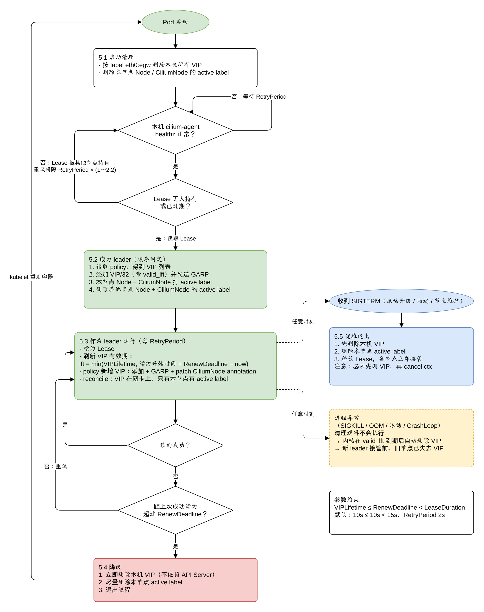

# cilium-egressgateway-ha 设计文档

## 1. 背景

Cilium 社区版的 Egress Gateway 可以把匹配的 Pod 流量转发到指定网关节点，并 SNAT 成固定的出口 IP（egressIP）。但它**不提供网关高可用**：

- 网关节点宕机后，流量不会切换到其他节点。
- Cilium 不会配置或迁移 egressIP（VIP）。

本项目通过一个运行在候选网关节点上的 DaemonSet，实现网关故障自动切换和 VIP 管理。

## 2. Cilium 社区版行为分析

以下结论基于 Cilium 源码（`pkg/egressgateway`）阅读，并在 kind 集群（Cilium v1.20.5，tunnel/vxlan，KPR）中验证。

### 2.1 网关节点选择

- 每个 cilium-agent 根据 policy 的 `egressGateway.nodeSelector` 匹配 **CiliumNode** 的 labels。
- 多个节点同时匹配时，按节点名排序取第一个。
- 选择时**不检查**节点 Ready 状态，也不检查 agent 是否存活，没有 health check。
- 节点宕机后，它的 CiliumNode 仍然存在，labels 也不变。Cilium 会继续选择它，导致流量黑洞。operator 只会在 k8s Node 对象被删除后，才回收对应的 CiliumNode。

### 2.2 CiliumNode labels 的来源

- CiliumNode 的 labels 由**该节点自己的 cilium-agent** 从 k8s Node 同步过去，operator 不负责同步。
- 节点正常时，修改 k8s Node 的 label 会自动同步到 CiliumNode，所有 agent 都能感知，**不需要重启 agent**。
- 节点宕机后，它的 agent 也停止了。这时修改 k8s Node 的 label **不会同步**到 CiliumNode，必须直接修改 CiliumNode。
- 节点恢复后，agent 会按 k8s Node 的 labels 覆盖 CiliumNode 的 labels。
- 如果配置了 `exclude-node-label-patterns`，匹配的 label 不会同步到 CiliumNode。

### 2.3 egressIP 的查找时机

- Cilium **不会**把 egressIP 配置到网卡上。它只在网关节点上查找"哪块网卡拥有这个 IP"（或者这个 IP 是否被配置为 local route）。查找成功后，把 egressIP 写入 BPF egress map。
- 查找失败时，egressIP 被写成 `0.0.0.0`，网关节点会以 `No Egress IP configured` 的原因丢弃流量。
- 查找**由事件触发**。只有以下事件会让所有 agent 重新计算网关配置（`reconcileLocked` → `regenerateGatewayConfigs`）：
  - policy 新增、修改或删除
  - **任意** CiliumNode 新增、更新或删除
  - agent 启动后首次同步完成
- **网卡 IP 的增删不会触发重新查找。** 查找失败后，即使把 VIP 加到网卡上，流量也不会自动恢复。官方文档建议重新 apply policy。
- 官方文档默认的使用前提是：egressIP 由运维**预先**配置在固定的网关节点上，然后再创建 policy。

### 2.4 VIP 冲突

- 同一个二层网络中，如果多个节点同时持有 VIP，外部设备通过 ARP 找到哪个节点是不确定的。回包可能被送到备节点。备节点上没有这条连接的 SNAT 状态，回包会被丢弃。实测 6/6 次请求全部失败。
- 把 VIP 配到 `lo` 上也不能解决问题：默认 `arp_ignore=0` 时，`eth0` 仍然会响应 VIP 的 ARP。
- 因此，**任何时刻只能有一个节点持有 VIP**。

### 2.5 验证结果汇总

| 场景 | 结果 |
|---|---|
| 主节点在线，去掉 Node label，VIP 未迁移 | gatewayIP 自动切到备节点，但备节点上没有 VIP，流量被丢弃 |
| 在上一场景的基础上再迁移 VIP | 不会自动恢复，需要重建 policy |
| 先迁移 VIP，再修改 label | 立即生效 |
| 主节点宕机，不做任何处理 | 流量黑洞 |
| 主节点宕机，去掉 Node label | 不会同步到 CiliumNode，流量不恢复 |
| 主节点宕机，去掉 CiliumNode label（VIP 已迁移） | 立即恢复 |
| 两个节点同时持有 VIP | 流量全部失败 |
| VIP 晚于 policy 生效，然后 patch 本节点 CiliumNode 的 annotation | 立即恢复 |
| VIP 晚于 policy 生效，然后给 Node 打非 `cilium.io` 前缀的 annotation | 不会同步，流量不恢复 |
| VIP 晚于 policy 生效，然后给 Node 打 `xxx.cilium.io/` 前缀的 annotation | 同步到 CiliumNode，流量恢复 |

## 3. 目标与非目标

**目标**

- 主网关节点故障时，自动把出口流量和 VIP 切换到备节点。
- 任何时刻只有一个节点持有 VIP，并且只有一个节点被 Cilium 选为网关。
- 不修改 Cilium，只使用社区版现有的行为。

**非目标**

- 切换时保持已有连接不断开。旧网关上的 SNAT 状态不会迁移，已有连接会断开。
- 在 API Server 不可用时完成切换。
- 多个网关之间的负载均衡。

## 4. 总体设计


上图是稳态下的架构。各候选节点上的 egw-ha Pod 通过同一个 Lease 选主。leader 节点 A 在本机网卡上添加带有效期的 VIP，再给 A 的 Node 和 CiliumNode 打上 `egress-gw-active` label。所有 cilium-agent 因此把 A 选为网关，业务 Pod 的出口流量经 VXLAN 送到 A，在 A 上 SNAT 成 VIP 后发往外部。备节点 B 只在本机 cilium-agent 健康时参与选主，Lease 过期后接管。

### 4.1 节点 label

| label | 维护者 | 含义 |
|---|---|---|
| `egress-gw-candidate=true` | 运维手动打，固定不变 | 候选网关节点，DaemonSet 只运行在这些节点上 |
| `egress-gw-active=true` | 程序自动维护 | 当前主网关。任何时刻最多只有一个节点有这个 label |

### 4.2 Egress policy

policy 的 nodeSelector 要**同时**匹配这两个 label。这样即使 `egress-gw-active` 被误打到非候选节点上，Cilium 也不会选中它。

```yaml
apiVersion: cilium.io/v2
kind: CiliumEgressGatewayPolicy
metadata:
  name: egress-app-a
spec:
  selectors:
  - podSelector:
      matchLabels:
        io.kubernetes.pod.namespace: app-a
        app: backend
  destinationCIDRs:
  - "0.0.0.0/0"
  excludedCIDRs:
  - "10.0.0.0/8"
  egressGateway:
    nodeSelector:
      matchLabels:
        egress-gw-candidate: "true"
        egress-gw-active: "true"
    egressIP: 192.168.10.100
```

程序只管理 nodeSelector 中包含 `egress-gw-active` 的 policy，并把这些 policy 的 IPv4 `egressIP` 作为 VIP。所有被管理的 policy 共用同一个主网关，切换时所有 VIP 一起迁移。

### 4.3 选主

- 候选节点上的每个 Pod 通过同一个 `coordination.k8s.io/Lease` 选主，可以使用 client-go 的 `leaderelection`。
- 所有候选节点平等，不设首选节点；原主节点恢复后不会主动切回。
- identity 使用 `<节点名>_<Pod UID>`，不能只用节点名：
  - 只用节点名时，如果 DaemonSet 配置了 `maxSurge>0`，同一个节点上会同时有两个 Pod，两个 Pod 都会认为自己是 leader。
  - 容器重启后，Pod UID 不变，所以会立即重新拿到 Lease，不用等 Lease 过期。实测中断时间为 1.6s（见第 9 节 D2）。
- 只有本机 cilium-agent 健康时，才参与选主。可以检查 `http://127.0.0.1:9879/healthz`（`agent-health-port`）。这是因为 egressIP 的查找，以及网关节点上的 BPF 配置，都由**新网关节点本机的** agent 完成。本机 agent 不可用时，即使其他节点已经把网关切过来，流量仍然无法恢复（见第 9 节 C2）。已经是 leader 的节点，agent 重启**不会**影响数据面（见第 9 节 C），所以健康检查只用来决定是否参选，不会让 leader 主动降级。
- 建议参数：`LeaseDuration=15s`、`RenewDeadline=10s`、`RetryPeriod=2s`。必须满足 `LeaseDuration > RenewDeadline`，并留出余量。这样旧 leader 会先放弃 VIP，新 leader 之后才能抢到 Lease。
  - 注意：client-go 的续约循环每次重新计算 RenewDeadline。旧 leader 实际放弃的时间大约是最后一次续约成功后 `RetryPeriod + RenewDeadline`，也就是 12s，和 15s 之间只有约 3s 余量。GC 停顿或 CPU 抢占都可能用完这段余量，所以需要用 VIP 有效期兜底（见 5.2）。
- 主节点宕机后，切换时间取决于以下因素：
  - 竞争者以**观察到 Lease 变化时的本地时间**为起点，计算 `LeaseDuration`。
  - acquire 重试的间隔是 `RetryPeriod × (1～2.2)`，其中 JitterFactor=1.2。
  - 加上这些因素后，理论范围约为 15～24s，再加上 Cilium 下发配置所需的约 1s。kind 实测 3 次，结果分别为 18.6s、20.8s、20.9s。

### 4.4 方案选择

#### 4.4.1 为什么不使用多节点匹配

多节点匹配方案的做法是：policy 的 nodeSelector 只匹配候选节点，Cilium 按节点名排序后选第一个作为主节点。主节点故障时，由某个组件删除它的 label，Cilium 就会选择下一个节点。

这个方案能实现切换，但真正使用时还要回答三个问题：

- 谁来判断主节点故障？
- 由谁来执行切换？
- 怎样避免两个节点同时持有 VIP？

如果要把这三个问题都解决，最后还是需要 Lease 这类机制。

| 问题 | 多节点匹配 | Lease 选主（本方案） |
|---|---|---|
| 谁是主节点 | 由 Cilium 按节点名排序决定。程序要自己复现 Cilium 的选择规则，才知道 VIP 应该配到哪个节点。这依赖 Cilium 的内部实现 | 由程序选主决定。policy 只匹配一个节点，所以 VIP 的位置和 Cilium 的选择总是一致 |
| 故障检测 | 备节点需要自己判断主节点是否故障。如果监听 Node Ready，默认至少要 40s 才能检测到 | 以 Lease 过期作为故障信号。检测时间可以配置，默认参数下约 15～24s |
| 误判时是否双主 | **会。** 比如只有 kubelet 挂了，或者主节点连不上 API Server，但主节点的网络仍然正常。这时备节点删除主节点的 label 并加上 VIP，主节点却不知道自己已被替换，还继续持有 VIP。两个节点同时持有 VIP，流量会全部中断（见 2.4） | **不会。** 主节点无法续约时，会在 `RenewDeadline` 时主动删除 VIP。新主节点要等 `LeaseDuration` 过期后才能接管，两者在时间上错开 |
| 多个备节点之间是否需要互斥 | 需要。有 3 个及以上候选节点时，多个备节点可能同时执行切换，需要另外加一把锁 | 不需要。Lease 本身就是互斥锁，同一时间只有一个节点执行切换 |
| 故障节点恢复后 | 候选 label 已经被删除，需要运维手动加回，否则候选节点会越来越少 | 候选 label 一直保留，节点恢复后自动成为备节点 |
| 是否强制切回 | **会。** 候选 label 加回后，原主节点的名字排序仍然最靠前，Cilium 会立即切回该节点。但 VIP 还在备节点上，流量会中断。这和"故障节点恢复后不切回"的决策冲突 | 不会。只有当前 leader 带有 active label |

关于"主节点宕机后 VIP 无法迁移"：如果节点真的宕机，它已经无法响应 ARP，新主节点直接添加 VIP 并发送 GARP 即可，两个方案在这里没有区别。真正的风险是**误判**：主节点看起来故障了，但实际上还活着。多节点匹配方案没有办法让旧主节点主动放弃 VIP；Lease 方案可以让旧主节点在续约失败后自我隔离。

所以，如果给多节点匹配补上故障检测、多个备节点之间的互斥，以及旧主节点的自我隔离，它最后就会变成 Lease 方案。剩下的区别只在于 label 的维护方式：多节点匹配需要反复删除和恢复候选 label，还会受到 Cilium 名字排序规则的影响；Lease 方案只切换一个 active label，候选节点集合不变。

#### 4.4.2 为什么不在每个节点上预先配置 VIP

把 VIP 预先配置在所有候选节点上，切换时就不需要迁移 VIP。但这个方案不可行：

- VIP 配在普通网卡上时，多个节点会同时响应 ARP，回包可能被送到备节点并被丢弃。实测流量全部失败（见 2.4）。
- VIP 配在 `lo` 上，并设置 `arp_ignore=1` 时，没有任何节点响应 ARP。上游需要通过静态路由或 BGP，把 VIP 指向当前主节点。这只是把"迁移 VIP"换成了"切换路由"，而且还要保证路由和 Cilium 选中的网关一致。在实际网络中很难落地。

## 5. 流程

下图是单个 egw-ha Pod 的完整状态流转，各步骤的细节见 5.1～5.5。



### 5.1 Pod 启动

1. **无条件**删除本机网卡上所有被管理的 VIP。VIP 添加时带有地址 label（例如 `eth0:egw`），所以按 label 删除即可，不依赖 API Server。
2. 删除本节点 Node 和 CiliumNode 上的 `egress-gw-active` label。
3. 本机 cilium-agent 健康后，再参与 Lease 选主（见 4.3）。

这里不需要先判断自己是不是主节点：刚启动的 Pod 不会是 leader。

### 5.2 成为 leader（`OnStartedLeading`）

顺序很重要：**先添加 VIP，再打 label。**

1. 读取需要管理的 policy，得到 VIP 列表。
2. 把 VIP 以 /32 添加到指定网卡上，**并设置有效期**（`valid_lft`/`preferred_lft`，见 5.3），然后发送 GARP。
3. 给**本节点**的 Node 和 CiliumNode 都打上 `egress-gw-active=true`。修改 CiliumNode 会触发 Cilium 重新查找 egressIP。这时 VIP 已经在网卡上，可以一次查找成功。直接修改 CiliumNode，是为了避免本机 agent 刚好重启时，label 同步被延迟。agent 恢复后会按 Node labels 覆盖 CiliumNode，两边的值一致，所以不会冲突。
4. 查找其他带有 `egress-gw-active=true` 的节点，删除它们 **Node 和 CiliumNode** 上的这个 label。旧 leader 可能已经宕机，它的 agent 不会同步 Node 上的 label 变化，所以 CiliumNode 必须单独处理。

### 5.3 作为 leader 运行

- **VIP 有效期（自我隔离）**：每次续约成功后，都刷新 VIP 的有效期，有效期计算公式为：

  `lft = min(VIPLifetime, 最后一次成功续约的请求开始时间 + RenewDeadline - now)`

  如果 `lft ≤ 0`，就不添加，也不刷新。这样设计是因为进程被 SIGKILL、OOM、panic，或者进入 CrashLoopBackOff 时，5.4 和 5.5 的清理都不会执行。hostNetwork 下 VIP 会一直留在宿主机网卡上，Lease 过期后，新 leader 加上 VIP，就会出现双主。设置有效期后，即使进程已经不存在，内核也会自动删除 VIP。实测到期后约 0.4s 内删除（见第 9 节 D3）。
  - **必须**以"续约请求的开始时间"计算有效期，不能用当前时间。原因是：进程如果在续约成功之后、刷新 VIP 之前被冻结（VM 暂停、长时间 GC），恢复后会按已经过期的续约结果重新添加 VIP 并发送 GARP，造成双主。kind 实测按当前时间计算时，这种情况下出现了约 2s 的双 VIP 和 3s 中断；改为按请求开始时间计算后，双 VIP 为 0（见第 9 节 D1）。
  - 必须满足 `VIPLifetime ≤ RenewDeadline < LeaseDuration`。默认参数下，`VIPLifetime=10s`。
- 监听 policy 变化：
  - 新增 egressIP 时：添加 VIP，发送 GARP，然后 **patch 本节点 CiliumNode 的 annotation**，例如 `egress-gw-ha/vip-synced=<timestamp>`，触发 Cilium 重新查找 egressIP。原因是 Cilium 收到 policy 事件时 VIP 还没加上，查找会失败，而且不会自动重试。
  - 删除 egressIP 时：删除对应的 VIP。多个 policy 可能共用同一个 egressIP，所以只有当所有被管理的 policy 都不再使用某个 egressIP 时，才能删除它。
- 定期 reconcile，例如每 10s 一次：
  - 检查 VIP 是否还在网卡上。如果被 NetworkManager 或 systemd-networkd 等组件删除，就重新添加，然后 patch annotation。
  - 检查是否只有本节点的 Node 和 CiliumNode 带有 `egress-gw-active`。
- annotation 只用来触发事件，不作为持久状态使用。agent 会覆盖 CiliumNode 的 annotations。
- 任意 CiliumNode 变化都会让所有 agent 重新计算网关配置，所以只在 VIP 变化后触发，不要频繁 patch。

### 5.4 失去 leader 身份（`OnStoppedLeading`）

这种情况通常是因为 Lease 无法续约，例如本节点连不上 API Server。

1. **立即删除本机所有 VIP。** 这一步只操作本机网卡，不依赖 API Server。即使这一步没有执行，VIP 也会因为有效期到期被内核删除。
2. 尽量删除本节点的 `egress-gw-active` label。失败也没关系，新 leader 会删除。
3. 退出进程，由 kubelet 重启 Pod 后进入 5.1 流程。

### 5.5 收到 SIGTERM（滚动升级、驱逐、节点维护）

1. 删除本机 VIP。
2. 删除本节点 Node 上的 `egress-gw-active` label。
3. 释放 Lease（`ReleaseOnCancel=true`），让备节点尽快接管。

**实现注意**：client-go 在 ctx 取消后会**先释放 Lease，然后才调用 deferred 的 `OnStoppedLeading`**。如果在 `OnStoppedLeading` 里删除 VIP，备节点可能已经抢到 Lease 并加上了 VIP，而旧节点的 VIP 还没删除。所以必须在 SIGTERM handler 里先删除 VIP，再 cancel ctx。

### 5.6 主节点宕机


| 时间 | 事件 |
|---|---|
| t0 | 主节点宕机，Pod、agent 和 VIP 都失效，CiliumNode label 仍然存在，流量黑洞 |
| t0 + ~15～23s | Lease 过期，备节点抢到 Lease，执行 5.2 流程（添加 VIP、发送 GARP、打 label、删除旧主节点 Node 和 CiliumNode 上的 label） |
| 再过约 1s | 所有 agent 把 gatewayIP 切到新主节点，新建连接恢复。kind 实测总中断时间为 18.6～20.9s |
| 旧主节点恢复 | Pod 启动后执行 5.1，确认没有 VIP。agent 按 Node labels 覆盖 CiliumNode，此时已经没有 active label，因此不会抢回主网关角色 |

## 6. 部署

### 6.1 DaemonSet 要求

- `nodeSelector: egress-gw-candidate: "true"`
- `hostNetwork: true`
- capabilities：`NET_ADMIN`（增删 IP）、`NET_RAW`（发送 GARP）
- `terminationGracePeriodSeconds` 要留出足够时间，用于删除 VIP 和释放 Lease。
- identity 已经包含 Pod UID，所以 `maxSurge` 不会造成双主。但是 `maxSurge>0` 时，新旧 Pod 会同时参与选主，切换行为不好预测。建议使用默认值 `maxSurge: 0`。

### 6.2 RBAC

| 资源 | 动作 |
|---|---|
| `coordination.k8s.io/leases`（本命名空间） | get, create, update |
| `nodes` | get, list, watch, patch |
| `cilium.io/ciliumnodes` | get, list, watch, patch |
| `cilium.io/ciliumegressgatewaypolicies` | get, list, watch |

### 6.3 配置参数

| 参数 | 说明 |
|---|---|
| `--interface` | VIP 所在网卡。不指定时，自动选择和 VIP 同网段的网卡 |
| `--candidate-label` / `--active-label` | label key，默认 `egress-gw-candidate` / `egress-gw-active` |
| `--lease-name` / `--lease-namespace` | Lease 对象的名称和命名空间 |
| `--lease-duration` / `--renew-deadline` / `--retry-period` | 选主参数 |
| `--vip-lifetime` | VIP 有效期，默认等于 `--renew-deadline`，必须满足 `≤ renew-deadline` |
| `--cilium-health-url` | 本机 cilium-agent 健康检查地址，默认 `http://127.0.0.1:9879/healthz` |

## 7. 限制与风险

- **已有连接会中断**：切换网关时，旧网关上的 SNAT 状态会丢失，已有 TCP 长连接需要应用重新连接。
- **依赖 API Server**：API Server 不可用时，leader 无法续约，会主动删除 VIP。这是为了避免双主而做的保守取舍。**注意影响范围**：控制面升级，或者 etcd 抖动超过约 RenewDeadline 时，**所有** egress 流量都会中断，而不部署本项目时 egress 不受影响。VIP 删除后，Cilium 的 BPF 仍然会用 VIP 做 SNAT，回包也仍然能按上游 ARP 缓存送回，所以中断不是立即发生，而是在上游的 ARP 表项过期以后才发生（见第 9 节 E、D3）。部署前需要评估控制面的可用性，必要时调大选主参数。
- **时钟**：client-go 用本地时钟记录"观察到 Lease 变化的时间"来判断是否过期，不比较不同节点的绝对时间，所以节点之间的时钟偏差不影响选主。会影响选主的是单个节点的时钟速率异常。
- **残留的竞态窗口**：在"判断续约是否有效"和"执行 `ip addr`"之间，进程如果被冻结，恢复后仍然可能按有效期上限添加一次 VIP。这个窗口只有两条相邻命令之间的时间，而且 VIP 最多保留到有效期结束，下一轮续约失败后也会被删除。用户态无法完全消除这个窗口。
- **GARP**：上游交换机或路由器必须接受 GARP，并及时更新 ARP 表。
- **外部组件冲突**：节点上的网络管理组件可能会删除程序添加的 VIP。程序通过定期 reconcile 恢复 VIP，但仍然要避免这类组件管理该网卡。
- **Cilium 行为依赖**：本设计依赖 Cilium 的内部行为，例如 CiliumNode 更新会触发重新查找 egressIP。升级 Cilium 前需要重新验证。

## 8. 设计决策

1. **不设首选主节点**：所有候选节点平等，完全按照 Lease 选主结果决定主节点。原主节点恢复后作为备节点运行，不主动切回。
2. **共用一个 Lease 和一个 active label**：所有被管理的 policy 共用同一个主网关。切换时，所有 VIP 一起迁移到新 leader。
3. **只支持 IPv4**：只管理 `egressIP` 为 IPv4 地址的 policy。`egressIP` 为 IPv6、或者未指定 `egressIP`（使用 `interface` 或默认路由网卡）的 policy 会被忽略，并输出日志。
4. **VIP 带有效期**：VIP 只在续约有效期内存在，由内核在进程失效后自动删除，不依赖进程退出时的清理逻辑。
5. **agent 健康才参选**：只有本机 cilium-agent 健康时，才参与选主；leader 不会因为本机 agent 不健康而主动降级。

## 9. kind 故障场景验证

环境：kind（Kubernetes v1.36.1），Cilium tunnel/vxlan + KPR，2 个候选节点（worker、worker2；C2' 额外加入 control-plane），client Pod 运行在 worker3 上，外部 target 是 docker 网络中的一个容器。原型是一个 bash 测试桩，按第 5 节流程实现，参数为 `LeaseDuration=15s`、`RenewDeadline=10s`、`RetryPeriod=2s`、`VIPLifetime=10s`。client 每 0.2s 请求一次 target，用请求结果计算中断时间；宿主机每 0.2s 检查一次两个节点上的 VIP，用来检测双主。

| 场景 | 操作 | 结果 | 中断时间 | 双 VIP |
|---|---|---|---|---|
| A 节点宕机 | `docker stop` leader 节点 | 备节点在 15～19s 后接管 | 18.6s / 20.8s / 20.9s | 无 |
| A' 节点 hang | `docker pause` leader 节点 | 22s 后切换。进程被冻结，但内核里的 eBPF 数据面仍然在转发，所以切换前流量一直正常 | 1.6s | 无 |
| G 故障节点恢复 | `docker start` 旧主节点 | 作为备节点运行，不切回 | 0 | 无 |
| B kubelet 宕机 | 停止 leader 的 kubelet，持续 90s | 节点变为 NotReady，但进程和 agent 都还在运行，Lease 正常续约，不切换 | 0 | 无 |
| C leader 的 agent 重启 | `kill -9` cilium-agent | BPF 数据面保持不变，agent 自动重启，不切换 | 0 | 无 |
| C2 备节点 agent 卡死时 leader 宕机（无健康检查） | SIGSTOP 备节点的 agent，再 `docker stop` leader | 新 leader 已经打上 label，其他节点也把网关切过来了，但本机 agent 没有下发 SNAT 配置，**流量持续中断**。agent 恢复后 0.1s 内流量恢复。所以需要"agent 健康才参选" | 直到 agent 恢复 | 无 |
| C2' 同上，加健康检查，3 个候选节点 | SIGSTOP worker 的 agent，再 `docker stop` leader（worker2） | worker 检测到 agent 不健康，不参与选主；control-plane 接管。agent 恢复后，worker 重新参与选主 | 18.7s | 无 |
| D1 进程挂起后恢复 | 在续约请求发出时 SIGSTOP leader 进程，37s 后 SIGCONT | 挂起期间 VIP 在 8.5s 时到期删除，17.9s 时备节点接管。恢复后，进程检测到续约结果已经过期，跳过 VIP，然后降级。**修复前**：恢复后的进程按过期的续约结果重新添加 VIP，导致约 2s 双 VIP 和 3s 中断 | 0.9s | 无（修复前有约 2s） |
| D2 进程被 kill，kubelet 正常 | `kill -9` leader 进程 | 容器立即重启，Pod UID 不变，所以立即重新拿到 Lease | 1.6s | 无 |
| D3 进程被 kill，并且无法重启 | 先停止 kubelet，再 `kill -9` leader 进程 | VIP 在 7.5s 时被内核自动删除，16.5s 时备节点接管。如果 VIP 没有有效期，会一直双主 | 1.6s | 无 |
| E leader 和 API Server 隔离 | iptables 丢弃发往 API Server 的报文 | 11s 时 leader 续约超时并降级，VIP 在 8.2s 时已经到期删除，14.7s 时备节点接管。网络恢复后，旧 leader 作为备节点运行 | 0 | 无 |
| F 删除 leader Pod | `kubectl delete pod`（SIGTERM） | 先删除 VIP，再释放 Lease。节点上新启动的 Pod 抢先拿到了 Lease | 2.3s | 无 |

补充说明：

- A'、D3、E 中的中断时间很短，原因是 VIP 删除后，旧网关的 BPF 仍然会用 VIP 做 SNAT，target 的 ARP 缓存也仍然指向旧网关，所以流量继续经过旧网关。新 leader 发送 GARP 并切换网关时，只中断约 1～2s。如果旧节点真的宕机（场景 A），中断时间就是完整的检测时间。
- 场景 A 的中断时间高于 `LeaseDuration`，原因见 4.3。如果需要更短的切换时间，可以按比例调小三个选主参数，但这会增加 API Server 的负载，也更容易因为 API Server 抖动而触发切换。
- 健康检查只能避免选中坏节点，不能凭空产生可用节点。如果只有 2 个候选节点，并且备节点的 agent 也不健康，leader 宕机后没有节点接管，出口会一直中断，直到某个 agent 恢复。生产环境建议至少部署 3 个候选节点。
