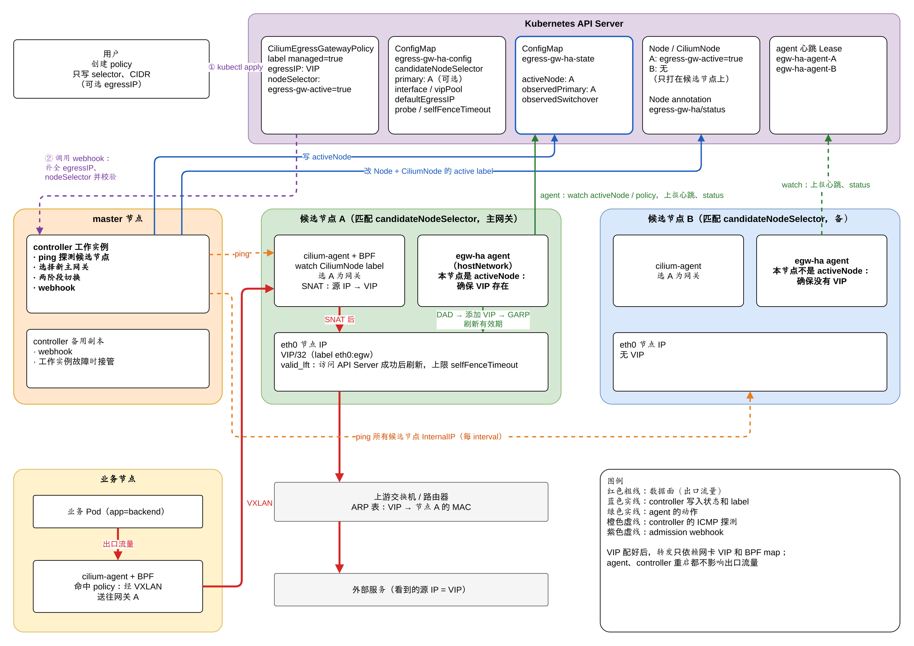
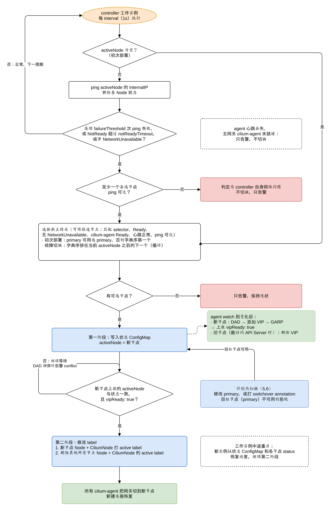

# cilium-egressgateway-ha 设计文档

参考文档：

- [Cilium Egress Gateway 行为分析](reference/cilium-behavior.md)：本项目依赖的 Cilium 行为和 kind 实测结果。
- [设计细节](reference/design-details.md)：CRD 字段和 conditions、探测、agent、webhook、部署、RBAC，以及方案选择的理由。

## 1. 背景

Cilium 社区版的 Egress Gateway 可以把匹配的 Pod 流量转发到网关节点，并 SNAT 成固定的出口 IP（egressIP）。但它**不提供网关高可用**：

- Cilium 按 policy 的 nodeSelector 选择网关节点，**不检查节点是否健康**。网关节点宕机后，Cilium 仍然选择它，出口流量黑洞。
- Cilium **不配置出口 IP**，只在网关节点上查找哪块网卡拥有这个 IP。找不到就丢弃流量，而且网卡上的 IP 变化后不会重新查找。
- 同一个二层网络中，如果多个节点同时持有出口 IP，回包可能被送到错误的节点，流量全部失败。

详细分析见 [Cilium Egress Gateway 行为分析](reference/cilium-behavior.md)。

**目标**

- 主网关节点故障时，自动把出口 IP 和出口流量切换到备节点。
- **控制面问题不影响数据面**：本项目的组件重启或升级、cilium-agent 重启、API Server 不可用，都不触发切换，也不中断出口流量。
- 任何时刻只有一个节点持有出口 IP，并且只有这个节点被 Cilium 选为网关。
- 不修改 Cilium，只使用社区版现有的行为。

**非目标**

- 切换时保持已有连接不断开。旧网关上的 SNAT 状态不会迁移，已有连接会断开。
- 在 API Server 不可用时完成切换。
- 多个网关之间的负载均衡。
- IPv6。

## 2. 原理



### 2.1 组件和对象

| 名称 | 形式 | 作用 |
|---|---|---|
| controller | Deployment，2 副本，运行在 master 节点上，用 Lease 选出一个工作实例 | 决定哪个节点是主网关；探测主网关；执行切换；维护 `egress-gw-active` label；提供 admission webhook |
| agent | DaemonSet，运行在候选节点上，`hostNetwork: true` | 本节点是主网关时，把出口 IP 配到网卡上，并上报状态；不是主网关时，删除出口 IP |
| `EgressGatewayHA` | 集群级 CR，全局只有一个，名字固定为 `default` | spec：候选节点、网卡、出口 IP、当前主网关 `activeNode`。status：切换进度和各节点状态 |
| `egress-gw-active=true` | Node 和 CiliumNode 上的 label | 只打在主网关上。policy 的 nodeSelector 匹配这个 label，所以 Cilium 选中的网关一定是主网关 |

controller 只负责做决定，agent 只负责执行。

### 2.2 数据面如何工作

1. 用户的 policy 中，nodeSelector 写的是 `egress-gw-active: "true"`。所有 cilium-agent 都把带这个 label 的节点作为网关，业务 Pod 的出口流量经 VXLAN 送到这个节点。
2. 主网关上的 agent 把出口 IP 以 /32 配到 `spec.interface` 上，并发送 GARP，让上游把出口 IP 指向这个节点。
3. 主网关上的 cilium-agent 找到网卡上的出口 IP，在 BPF 中把出口流量 SNAT 成这个 IP。

出口 IP 配好以后，转发只依赖两样东西：网卡上的出口 IP，以及 Cilium 的 BPF map。它和 controller、agent、API Server 都没有关系。这是"控制面问题不影响数据面"的基础：

- agent 重启或升级时不删除出口 IP，新 Pod 启动后直接沿用。
- controller 重启时，只是暂停切换决策。
- API Server 不可用时，agent 保持网卡现状不变。

### 2.3 两个关键约束

- **任何时刻只有一个节点持有出口 IP**，否则回包会被送到错误的节点。
- **先配置出口 IP，再打 label**。Cilium 只在 label 或 policy 变化时查找出口 IP，如果先打 label，查找会失败，而且不会重试。

controller 用两阶段切换同时满足这两个约束：先让新节点配好出口 IP（新节点添加前先做重复地址检测），确认配好后，再把 label 移到新节点（见第 4 章）。

### 2.4 主网关记录在哪里

- **`spec.activeNode` 是主网关的唯一来源。** 默认为空，controller 选出主网关后写入；故障切换时由 controller 修改；运维修改这个字段就是手动切换。
- `status.activeNode` 由主网关上的 agent 写入，展示这个节点上出口 IP 的实际状态：节点名、已经配置的出口 IP、是否全部配好、是否有冲突。
- 切换是否完成，以 `egress-gw-active` label 实际所在的节点为准：label 还没有打在 `spec.activeNode` 上，说明正在切换，`Switching` condition 会写明从哪个节点切到哪个节点。
- 其他 spec 字段的默认值来自 Helm values。controller 只在 CR 不存在时创建它，之后以 CR 为准。

CRD 的完整字段和 conditions 见[设计细节](reference/design-details.md)第 1 章。

## 3. 什么时候切换

controller 的工作实例持续检查主网关，满足以下**任意一个**条件时，判定主网关故障：

| 条件 | 典型原因 | 检测时间 |
|---|---|---|
| TCP 探测连续 3 次失败 | 节点宕机、网络不可达 | 约 16～21s |
| Node 的 Ready condition 为 `False` 或 `Unknown` | kubelet 故障、节点和 API Server 断开 | 约 40～50s |

另外两种情况也会切换：主网关不再匹配 `candidateNodeSelector`；运维修改了 `spec.activeNode`。

### 3.1 TCP 探测规则

- 探测主网关 InternalIP 上的 kubelet 端口（默认 10250）。
- 串行探测：单次超时 2s；一次探测结束后，等 5s 再发起下一次；连续 3 次失败才判定故障。
- **连接成功或被拒绝（`ECONNREFUSED`）都算存活。** 被拒绝说明节点内核收到了 SYN 并回了 RST，节点没有宕机，只是 kubelet 没有监听。
- 连接超时，以及 `EHOSTUNREACH` 等其他错误，都算失败。
- controller 自己的网络出问题时，所有节点都会探测失败。所以因 TCP 探测失败切换前，至少要有一个备选节点探测成功，否则不切换，只告警。

为什么用 TCP 连接，而不是 ping 或 HTTP healthz，以及 kind 实测结果，见[设计细节](reference/design-details.md)第 2 章。

### 3.2 各种事件的结果

| 事件 | 是否切换 | 出口流量 |
|---|---|---|
| 主网关宕机或网络不可达 | 是 | 中断约 18～23s（推算值） |
| 主网关 kubelet 停止，超过约 40～50s | 是（Node NotReady） | 切换前正常；切换时已有连接断开 |
| 主网关 kubelet 短暂重启 | 否：TCP 连接被拒绝算存活，Node 还没有变为 NotReady | 不受影响 |
| agent 升级、重启、被删除 | 否 | 不受影响 |
| cilium-agent 重启 | 否 | 不受影响，BPF map 保持不变 |
| controller 重启或副本切换 | 否 | 不受影响，切换决策暂停 |
| API Server 不可用 | 否 | 不受影响 |
| 主网关和 controller、API Server 之间网络分区，二层正常 | 尝试切换，但停在第一阶段（见 4.3） | 不受影响；分区恢复后完成切换，已有连接断开一次 |
| 故障节点恢复 | 否，不切回 | 不受影响 |
| 运维修改 `spec.activeNode` | 是 | 短暂中断，已有连接断开 |

以下信号**不触发切换**，只记录 Event 和 metrics：

- `NetworkUnavailable` condition：Cilium 只在启动时设置一次，不能反映运行时状态。
- 主网关上的 agent Pod 未就绪、cilium-agent 未就绪：它们重启时，网卡上的出口 IP 和 BPF map 都保持不变。

## 4. 如何切换



### 4.1 选择新主网关

可用的候选节点必须满足：匹配 `candidateNodeSelector`、TCP 探测成功、Node Ready、cilium-agent Ready、agent Pod Ready。后两个条件用来避开"切过去也无法转发"的节点：没有 agent，就没有人配置出口 IP；没有 cilium-agent，就不会下发 SNAT 配置。

| 触发原因 | 选择规则 |
|---|---|
| 初次部署（`spec.activeNode` 为空） | 字典序第一个 |
| 故障切换，或主网关不再是候选节点 | 按字典序排列可用节点，选排在当前主网关之后的下一个；当前主网关已经排在最后时，回到第一个 |
| 手动切换 | 运维指定的节点 |

例如候选节点为 node1、node2、node3，当前主网关是 node2：node2 故障时选 node3；node3 也不可用时选 node1。

没有可用节点时保持现状，`Switching` condition 的 reason 为 `NoAvailableCandidate`。

### 4.2 两阶段切换

**第一阶段：配置出口 IP**

1. controller 把 `spec.activeNode` 改为新节点（手动切换时，运维已经改好）。
2. 新节点的 agent 对每个出口 IP 做重复地址检测（相当于 `arping -D`）。没有设备回应时，以 /32 添加到网卡上，发送 GARP，然后 patch 本节点 CiliumNode 的 annotation，触发 Cilium 重新查找出口 IP。
3. 新节点的 agent 把 `status.activeNode` 写为 `{name: 新节点, egressIPs: [...], ready: true}`。
4. 旧节点的 agent 如果还能访问 API Server，看到自己不再是主网关，会删除本机的出口 IP。

**第二阶段：移动 label**

controller 看到 `status.activeNode.name` 等于 `spec.activeNode`，并且 `ready` 为 true 后：

1. 给新节点的 Node 和 CiliumNode 打上 `egress-gw-active=true`。所有 cilium-agent 把网关切到新节点，新节点上的出口 IP 已经存在，可以立即生效。
2. 删除其他所有节点 Node 和 CiliumNode 上的这个 label。旧节点宕机时，它的 cilium-agent 不会把 Node label 的变化同步到 CiliumNode，所以要直接修改 CiliumNode。
3. 设置 `Switching=False`，切换完成。

controller 在切换中途重启时，新实例比较 `spec.activeNode`、label 所在的节点、`status.activeNode`，以及记录切换来源的 annotation，从中断的位置继续。例如第二阶段中途重启，两个节点都带有 label 时，继续删除旧节点上的 label。

### 4.3 双主防护

- **重复地址检测**：旧节点还在回应出口 IP 的 ARP 时，新节点不添加出口 IP，切换停在第一阶段，reason 为 `EgressIPConflict`。
- **出口 IP 配好之前不移动 label**：切换停在第一阶段时，label 仍然在旧节点上，流量仍然走旧节点。如果旧节点只是和 controller、API Server 断开，它的数据面仍然正常，**出口流量不中断**。
- 旧节点恢复访问 API Server 后，它的 agent 会删除出口 IP；新节点的重复地址检测随之通过，切换完成。

### 4.4 手动切换

运维直接修改 `spec.activeNode`，例如维护前把主网关切走，或者故障恢复后切回原来的节点：

```bash
kubectl patch egressgatewayha default --type merge -p '{"spec":{"activeNode":"node1"}}'
```

- webhook 校验目标节点存在，并且是候选节点。
- 之后按 4.2 的两阶段流程切换。
- 目标节点不可用时，controller 把 `spec.activeNode` 恢复为当前带 label 的节点，并记录 Warning Event，reason 为 `TargetUnavailable`。

## 5. 节点故障处理


### 5.1 主网关宕机

| 时间 | 事件 |
|---|---|
| t0 | 主网关宕机，出口 IP 随之失效。CiliumNode 上的 label 仍然存在，Cilium 仍然把流量送到这个节点，出口流量黑洞 |
| t0 + 16～21s | controller 连续 3 次 TCP 探测超时，确认有备选节点可达，选出 node2，写入 `spec.activeNode` |
| 再过约 1s | node2 的 agent 做重复地址检测（宕机节点不再回应），添加出口 IP，发送 GARP，上报 `ready: true` |
| 再过约 1s | controller 给 node2 打 label，删除旧节点 Node 和 CiliumNode 上的 label，所有 cilium-agent 把网关切到 node2，新建连接恢复 |

总中断时间约 18～23s。以上时间是根据默认参数推算的，尚未实测。

### 5.2 故障节点恢复

- 出口 IP 只配置在内核中，不写入节点的网络配置文件，所以节点重启后出口 IP 已经不存在。
- agent 启动后发现本节点不是 `spec.activeNode`，按地址 label（例如 `eth0:egw`）删除残留的出口 IP，然后作为备节点运行。
- **不会自动切回**，以免已有连接再断开一次。需要切回时，由运维手动切换（见 4.4）。

### 5.3 kubelet 故障

- kubelet 停止约 40～50s 后，Node 变为 NotReady，触发切换。
- 这时旧节点的数据面通常仍然正常，并且仍然持有出口 IP：
  - 旧节点的 agent 能访问 API Server 时，会自己删除出口 IP，切换随即完成，已有连接断开。
  - 旧节点的 agent 也无法访问 API Server 时，切换停在第一阶段，流量继续走旧节点（见 4.3）。
- kubelet 升级前，建议先手动把主网关切走。

### 5.4 agent 的启动和退出


- **启动**：本节点是主网关时，确保出口 IP 存在，**不先删除**，直接沿用升级前留下的出口 IP；不是主网关时，删除本机的出口 IP。无法访问 API Server 时，保持网卡现状不变。
- **运行中**：watch `EgressGatewayHA` 和 policy，并每 10s reconcile 一次。出口 IP 被其他组件删除时，会重新添加。
- **退出（SIGTERM）**：不删除出口 IP，也不修改 label，所以 agent 升级不影响出口流量。例外：本节点已经不是候选节点时，删除出口 IP（即使它仍是主网关，controller 也会把它切走）。

agent 的详细流程见[设计细节](reference/design-details.md)第 3 章。

## 6. 使用

### 6.1 Egress policy

nodeSelector 中引用了 `egress-gw-active` 的 policy，就由本项目管理，不需要额外的 label 或 annotation：

```yaml
apiVersion: cilium.io/v2
kind: CiliumEgressGatewayPolicy
metadata:
  name: egress-app-a
spec:
  selectors:
  - podSelector:
      matchLabels:
        io.kubernetes.pod.namespace: app-a
        app: backend
  destinationCIDRs:
  - "0.0.0.0/0"
  excludedCIDRs:
  - "10.0.0.0/8"
  egressGateway:
    nodeSelector:
      matchLabels:
        egress-gw-active: "true"
    # egressIP 可以不写，由 webhook 填入 defaultEgressIP
```

webhook 的规则：

- nodeSelector **只能**是 `egress-gw-active: "true"`，不能有其他条件。否则当前主网关不满足其他条件时，流量会被丢弃。
- egressIP 可以不写，由 webhook 补全为 `defaultEgressIP`。填写时，必须在 `spec.egressIPs` 中。
- **不能填写 `interface`**。Cilium 不允许同时填写 `egressIP` 和 `interface`，否则会忽略整个 policy。出口 IP 配在哪块网卡，由 `EgressGatewayHA.spec.interface` 决定。
- 多个 policy 可以使用同一个 egressIP。
- 不匹配的 policy（nodeSelector 中没有 `egress-gw-active`）不会发送到 webhook，完全不受影响。

webhook 的完整规则见[设计细节](reference/design-details.md)第 4 章。

### 6.2 Helm values

```yaml
egressGatewayHA:                    # controller 创建 EgressGatewayHA default 时使用，只在 CR 不存在时生效
  candidateNodeSelector:
    matchLabels:
      node-role.example.com/egress: "true"
  interface: eth0
  egressIPs:                        # 支持单个 IP 和地址范围
  - 192.168.10.100-192.168.10.110
  defaultEgressIP: ""               # 为空时取 egressIPs 中的第一个

controller:
  nodeProbe:
    port: 10250                     # 探测节点上的 TCP 端口，默认是 kubelet 端口
    timeout: 2s                     # 单次 TCP 连接超时，期间内核会自动重传 SYN
    interval: 5s                    # 上一次探测结束后，等待多久发起下一次
    failureThreshold: 3             # 连续失败多少次后判定节点故障

agent:
  garpInterval: 0s                  # 周期性发送 GARP 的间隔，0 表示只在添加出口 IP 时发送
  reconcileInterval: 10s            # agent 定期 reconcile 的间隔
```

`egressGatewayHA` 部分只在初次部署时使用。CR 创建后，修改配置需要直接修改 CR，`helm upgrade` 不会覆盖它。修改候选节点时，需要同时修改 CR 和 Helm value，因为 agent DaemonSet 的调度范围由 Helm value 决定。

### 6.3 查看状态

```console
$ kubectl get egressgatewayha
NAME      ACTIVE   REACHABLE   READY   AGE
default   node1    True        True    3d
```

`status.conditions` 按切换过程划分：

| condition | 含义 |
|---|---|
| `ActiveNodeElected` | 已经选出主网关，label 已经在这个节点上 |
| `ActiveNodeReachable` | 主网关的 TCP 探测结果 |
| `ActiveNodeReady` | 主网关 Node 的 Ready 状态 |
| `Switching` | 正在切换，reason 说明当前停在哪一步 |
| `GatewayReady` | 出口 IP 已经配到主网关的网卡上（由主网关的 agent 写入） |
| `Ready` | 以上都正常 |

reason 和 message 的详细说明见[设计细节](reference/design-details.md)第 1.3 节。

## 7. 限制与风险

- **已有连接会断开**：切换时旧网关上的 SNAT 状态不会迁移，TCP 长连接需要应用重新建立。
- **kubelet 故障会触发切换**：kubelet 停止或升级超过约 40～50s，Node 变为 NotReady，会触发切换。kubelet 升级前，建议先手动切走主网关。
- **网络分区恢复时可能短暂双主**：旧主网关在二层也被完全隔离时，新节点的重复地址检测会通过，切换完成。分区恢复时，如果旧节点的 agent 也不可用（例如一直 CrashLoop），两个节点会同时持有出口 IP，直到旧节点的 agent 恢复。需要依靠告警发现。
- **重复地址检测的局限**：旧节点仍然回应 ARP，但已经无法转发，并且它的 agent 也无法访问 API Server 时，切换会一直停在第一阶段，出口中断，需要人工处理。
- **只有一个观察点**：探测只从 controller 所在节点发起。如果只是 controller 到主网关这一条路径故障，会尝试切换，但重复地址检测会阻止新节点添加出口 IP，流量继续走旧节点。
- **探测端口的防火墙**：
  - 中间防火墙对 `nodeProbe.port` 直接丢包时，探测会超时，节点会被误判为故障。
  - 中间防火墙代替节点回 RST 时，节点宕机后探测仍然被判定为存活，故障检测不到。
  - 节点本机防火墙的 REJECT 没有问题，因为能回 RST 本身就说明节点还活着。
- **出口网卡和探测网卡不同**：探测的是 InternalIP 所在的网卡。如果出口 IP 配在另一块网卡上，出口网卡断开时不会触发切换。这种部署需要另外监控出口网卡的链路状态。
- **新节点的 agent 不可用时无法切换**：所以选择新主网关时会检查 agent Pod 是否 Ready。生产环境建议至少部署 3 个候选节点。
- **GitOps**：controller 会修改 `spec.activeNode`。用 ArgoCD、Flux 管理 `EgressGatewayHA` 时，需要忽略这个字段，否则会被改回去，触发一次切换。
- **GARP**：上游交换机或路由器必须接受 GARP，并及时更新 ARP 表。
- **外部组件冲突**：节点上的网络管理组件可能会删除出口 IP。agent 会定期 reconcile 恢复，但仍然要避免这类组件管理该网卡。
- **依赖 Cilium 的内部行为**：例如 CiliumNode 更新会触发重新查找出口 IP。升级 Cilium 前需要重新验证（见 [Cilium Egress Gateway 行为分析](reference/cilium-behavior.md)）。
